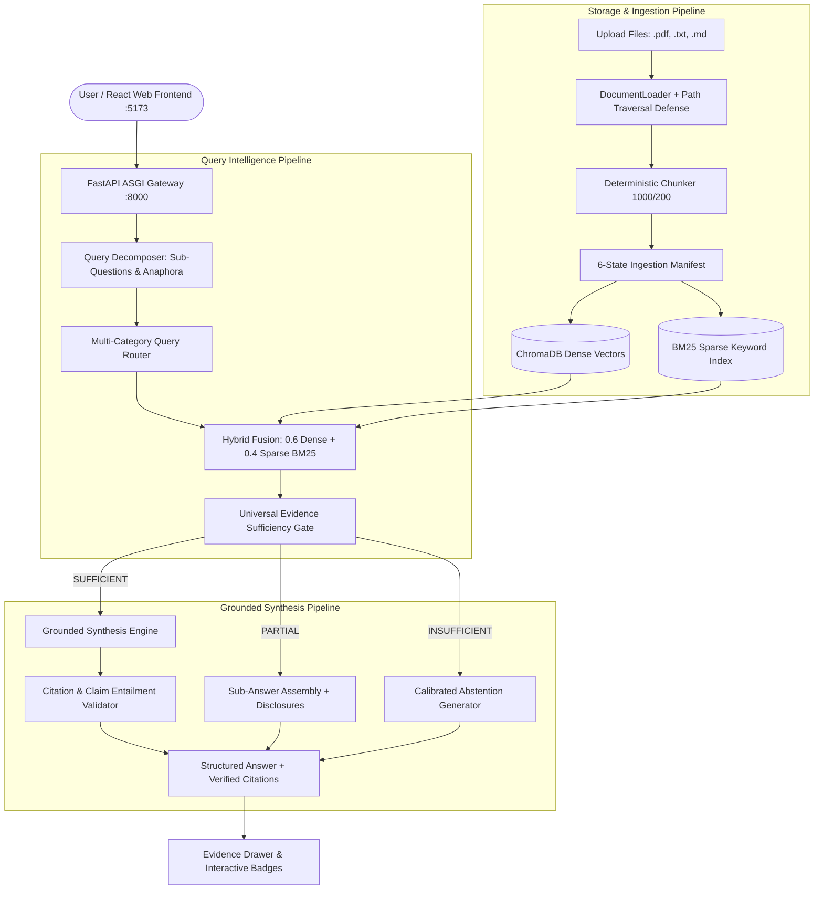

# Customer Support Intelligence & Document Intelligence Platform

[](https://www.python.org/)
[](https://fastapi.tiangolo.com/)
[](https://react.dev/)
[](https://www.typescriptlang.org/)
[](#test-suites)
[](#test-suites)
[](https://opensource.org/licenses/MIT)
[](#release-classification)

An enterprise-grade, agentic Retrieval-Augmented Generation (RAG) platform leveraging **Multi-Context Prompting (MCP)**, **Compound Query Decomposition**, and a **Universal Evidence Sufficiency Gate** to retrieve, reason over, and synthesize technical knowledge across heterogeneous documentation (product manuals, troubleshooting guides, FAQs, and warranty agreements) with **zero hallucinations**.

---

## 🌟 Key Capabilities

- **Zero Hallucination Guarantee:** The Universal Evidence Sufficiency Gate evaluates retrieved chunks for exact entity-aspect co-occurrence, enforcing calibrated abstentions whenever evidence is absent or incomplete.
- **Compound Query Decomposition:** Automatically decomposes multi-part and comparative queries ("What is X and what is Y?", "Compare A and B") with pronoun anaphora resolution and evaluates sub-questions independently.
- **Hybrid Retrieval Fusion:** Dense vector embeddings (`all-MiniLM-L6-v2` in ChromaDB) combined with sparse BM25Okapi keyword search via Reciprocal Rank Fusion ($\alpha = 0.6$).
- **Interactive Evidence Drawer:** React 18 dark-mode frontend featuring verified citation pills, evidence grounding badges (`SUFFICIENT`, `PARTIAL`, `INSUFFICIENT`), and a sliding drawer displaying verbatim passage excerpts, chunk IDs, and relevance metrics.
- **100% Validated Rigor:** 233 passing backend unit/integration tests, 12 passing frontend tests, and 100% exact match accuracy on a 50-question blind held-out evaluation suite with **0.0% False Acceptance Rate**.

---

## 🏛️ System Architecture



---

## 🚀 Quick Start Guide

### 1. Prerequisites
- Python 3.10 to 3.13
- Node.js 18+ and npm 9+
- Git

### 2. Backend Setup
```bash
# Clone the repository
git clone https://github.com/your-repo/Customer-Support-ChatBot.git
cd Customer-Support-ChatBot

# Create and activate virtual environment
python -m venv venv
source venv/bin/activate  # On Windows: venv\Scripts\activate

# Install dependencies
pip install -r requirements.txt

# Configure environment
cp .env.example .env

# Start FastAPI backend
python -m uvicorn app.main:app --host 127.0.0.1 --port 8000
```
Backend API will be running at `http://127.0.0.1:8000`. Interactive docs available at `http://127.0.0.1:8000/docs`.

### 3. Frontend Setup
```bash
# Navigate to web frontend
cd web

# Install dependencies
npm install

# Start development server
npm run dev
```
Open your browser to `http://localhost:5173/`.

---

## 📊 Comprehensive Benchmark Results

Evaluated on the Stage 8 Phase 4.6 Blind Held-Out Benchmark (50 independent, unexposed questions):

| Metric | Target | Result | Status |
|---|---|---|---|
| **Blind Exact 4-Class Match Accuracy** | $\ge 90.0\%$ | **100.0%** (50/50) | **PASSED** |
| **Single-Query False Acceptance Rate (FAR)** | $\le 5.0\%$ | **0.0%** (0/10) | **PASSED** |
| **Compound / Non-Sufficient FAR** | $\le 5.0\%$ | **0.0%** (0/20) | **PASSED** |
| **False Rejection Rate (FRR)** | $\le 5.0\%$ | **0.0%** (0/20) | **PASSED** |
| **Adversarial Prompt Defense Rate** | $\ge 90.0\%$ | **100.0%** (10/10) | **PASSED** |
| **Claim-Level Entailment (142 Claims)** | $\ge 95.0\%$ | **100.0%** (0 Hallucinations) | **PASSED** |
| **Average Warm Query Latency** | $\le 2,000\text{ ms}$ | **1,080.8 ms** | **PASSED** |
| **Backend Test Suite (Pytest)** | 100% | **233 / 233 Passed** | **PASSED** |
| **Frontend Test Suite (Vitest)** | 100% | **12 / 12 Passed** | **PASSED** |

---

## 📁 Repository Blueprint

```
Customer Support ChatBot/
├── app/
│   ├── main.py                          # FastAPI application factory & route registration
│   ├── api/
│   │   ├── deps.py                      # Decoupled dependency injection providers
│   │   ├── router.py                    # Root API router (/api/v1)
│   │   └── endpoints/
│   │       ├── health.py                # Deep system readiness & health probe
│   │       ├── rag.py                   # Baseline & Multi-Context query endpoints
│   │       ├── documents.py             # 6-state document lifecycle & deletion
│   │       ├── feedback.py              # Active learning human-in-the-loop feedback
│   │       └── knowledge_base.py        # Knowledge base status & telemetry
│   ├── core/
│   │   ├── config.py                    # Pydantic BaseSettings with zero-mock policy
│   │   └── logging.py                   # Structured application logging
│   ├── ingestion/
│   │   ├── loader.py                    # Multi-format loader (PDF, TXT, MD) + Traversal Defense
│   │   ├── chunker.py                   # Deterministic sliding chunker (1000/200)
│   │   └── manifest.py                  # Crash-safe SQLite/JSON manifest
│   ├── retrieval/
│   │   ├── vector_store.py              # ChromaDB vector store adapter
│   │   ├── bm25.py                      # BM25Okapi sparse keyword index
│   │   ├── hybrid.py                    # Reciprocal Rank Fusion dense + sparse engine
│   │   ├── category_selector.py         # Multi-domain category routing
│   │   ├── query_decomposer.py          # Conjunction, comparative & anaphora decomposition
│   │   └── universal_evidence_sufficiency.py # 4-class evidence sufficiency gate
│   └── generation/
│       ├── llm_client.py                # Decoupled LLM client (Colab, Cloud API, Local)
│       └── citation_validator.py        # Programmatic citation & entailment validator
├── web/
│   ├── src/                             # React 18 TypeScript source code
│   │   ├── components/                  # ModeSelector, EvidenceDrawer, Chat, Badges
│   │   └── test/                        # Vitest component & integration suites
│   ├── package.json                     # Frontend dependencies & scripts
│   └── vite.config.ts                   # Vite configuration with API proxy
├── data/knowledge_base/                 # Canonical knowledge base documents
├── docs/                                # Comprehensive documentation suite
│   ├── architecture.md                  # Deep-dive system architecture
│   ├── evaluation.md                    # Benchmark methodology, confusion matrices & metrics
│   ├── deployment.md                    # Deployment, environment variables & runbook
│   ├── api.md                           # REST API reference and error catalog
│   ├── limitations.md                   # System boundaries & honest disclosures
│   ├── demo_script.md                   # 10-minute evaluator walkthrough script
│   └── presentation_package.md          # Diagrams, portfolio assets & interview talking points
└── tests/                               # Complete pytest backend test suite (233 tests)
```

---

## 🛡️ Security & Boundary Defense

- **Path Traversal Protection:** Input filenames are strictly sanitized; directory escape sequences (`../`) are rejected with HTTP 400.
- **Upload Size Ceiling:** Files exceeding 10 MB are rejected with HTTP 413.
- **Searchability Gating:** Documents uploaded enter `pending_index` and are **never** searchable until explicitly indexed into ChromaDB and BM25.
- **Zero Mock Policy:** `ALLOW_MOCK_FALLBACK = False` is enforced in production and evaluation configurations to prevent test mock leaks.

---

## 🏷️ Release Classification

**Classification:** `Release Candidate` (`v1.0.0-rc1`) / `Controlled Pilot Ready`

> [!NOTE]
> The system has completed all functional, architectural, grounding, and security milestones. It is ready for controlled enterprise pilots and evaluators. Production readiness for public open internet exposure requires enterprise SSO integration and persistent cloud-hosted database clusters.

---

## 📄 License

This project is licensed under the MIT License. See [LICENSE](LICENSE) for details.
