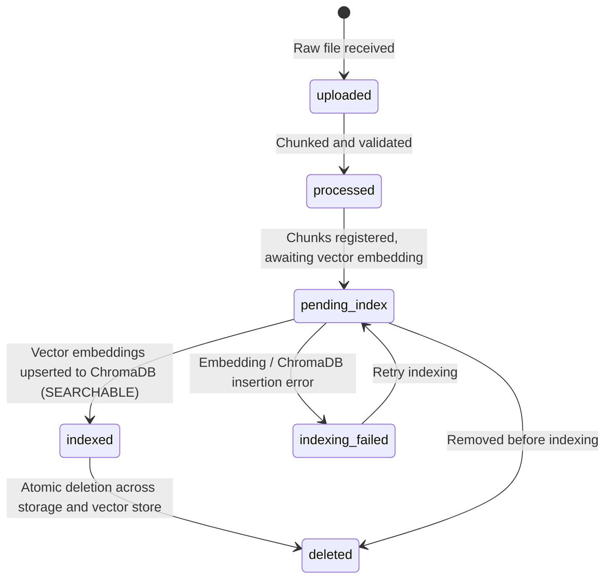

# Customer Support Intelligence Assistant — API Reference Manual (Stage 5)

## 1. Architecture & Design Principles

The Customer Support Intelligence Assistant API is built with **FastAPI** to deliver high-throughput, asynchronous, and deterministic Retrieval-Augmented Generation (RAG).

### Key Architectural Standards
1. **Decoupled Dependency Injection**: All endpoints consume components via FastAPI's `Depends(...)` providers defined in [`app/api/deps.py`](file:///C:/Users/surya/Internship_RAG_MCP_Capstone/app/api/deps.py). This enables zero-side-effect unit and integration test overrides via `app.dependency_overrides`.
2. **Canonical & Root Aliasing**: All canonical endpoints exist under `/api/v1/...` and also expose direct root shortcuts (`/health`, `/ready`, `/query`, `/documents`, `/knowledge-base/status`) for Kubernetes/Cloud probes.
3. **Explicit Error Boundaries**: Never falls back to silent mocks in production or normal development. Missing or uninitialized vector stores return HTTP 503; remote LLM timeouts return HTTP 504; disconnected inference runtimes return HTTP 502; validation failures return HTTP 400 or 422.
4. **Document Searchability Boundary**: A document is NEVER marked searchable (`is_searchable = false`) until its dense chunks are completely indexed into ChromaDB.

---

## 2. Document Lifecycle State Machine

Every ingested document transitions across six distinct, mutually-exclusive states:



| Lifecycle State | Searchable? | Description |
| :--- | :--- | :--- |
| `uploaded` | ❌ No | Raw bytes received and stored in staging directory. |
| `processed` | ❌ No | Loaded, validated, and decomposed into semantic chunks. |
| `pending_index` | ❌ No | Manifest registered with chunk metadata; awaiting vector database upsert. |
| `indexed` | **✅ Yes** | Dense embeddings generated and indexed in ChromaDB. Available for RAG retrieval. |
| `indexing_failed` | ❌ No | Vector store or embedding provider failed during chunk upsert. |
| `deleted` | ❌ No | Marked deleted in manifest; chunks purged from vector store and BM25 index. |

---

## 3. Endpoints Specification

### 3.1 Health & Readiness Diagnostics

#### `GET /api/v1/health` (Alias: `GET /health`)
Fast liveness probe reporting system uptime, configuration, and storage mounts.

- **Response Code**: `200 OK`
- **Response Schema**:
```json
{
  "status": "healthy",
  "app_name": "Multi-Context Intelligent RAG System",
  "version": "0.1.0",
  "environment": "development",
  "uptime_seconds": 142.5,
  "storage": {
    "google_drive_connected": true,
    "google_drive_root": "G:\\My Drive\\Internship_RAG_MCP_Capstone",
    "local_free_disk_gb": 66.96,
    "storage_budget_mb": 1024
  },
  "compute": {
    "llm_provider": "colab_remote",
    "model_name": "mistralai/Mistral-7B-Instruct-v0.3"
  }
}
```

#### `GET /api/v1/ready` (Alias: `GET /ready`)
Deep readiness probe verifying all critical subsystems: Google Drive persistent storage, manifest file, ChromaDB vector collection, embedding provider, and LLM configuration.

- **Response Codes**:
  - `200 OK`: All subsystems ready.
  - `503 Service Unavailable`: One or more subsystems uninitialized or unreachable.
- **Response Schema (Ready)**:
```json
{
  "status": "ready",
  "ready": true,
  "checks": {
    "storage": true,
    "manifest": true,
    "vector_store": true,
    "embedding_provider": true,
    "llm_provider": true
  },
  "details": {
    "google_drive_connected": true,
    "vector_store_collection": "apexprint_knowledge_base",
    "indexed_chunks_count": 21,
    "llm_provider": "colab_remote",
    "environment": "development"
  }
}
```
- **Response Schema (Unready - 503)**:
```json
{
  "status": "not_ready",
  "ready": false,
  "checks": {
    "storage": true,
    "manifest": true,
    "vector_store": false,
    "embedding_provider": true,
    "llm_provider": true
  },
  "details": {
    "google_drive_connected": true,
    "vector_store_collection": null,
    "indexed_chunks_count": 0,
    "llm_provider": "colab_remote",
    "environment": "development"
  }
}
```

---

### 3.2 RAG Query Engine

#### `POST /api/v1/query` (Aliases: `POST /query`, `POST /api/v1/rag/query`, `POST /rag/query`)
Executes customer support inquiry retrieval and synthesis in either Baseline or Multi-Context mode.

- **Request Body**:
```json
{
  "query": "What is the warranty coverage for ProX-400 and how to fix error E-101?",
  "session_id": "cust-session-882",
  "top_k": 5,
  "retrieval_mode": "multi_context"
}
```

| Parameter | Type | Required | Default | Description |
| :--- | :--- | :--- | :--- | :--- |
| `query` | string | **Yes** | — | Customer question (minimum 1 non-whitespace character). |
| `session_id` | string | No | `"default-session"` | Conversation session tracking ID. |
| `user_id` | string | No | `null` | Optional customer identity. |
| `top_k` | integer | No | `5` | Maximum candidate context chunks to retrieve (1–20). |
| `retrieval_mode` | string | No | `"multi_context"` | `"baseline"` (dense semantic) or `"multi_context"` (MCP hybrid). |

- **Response Code**: `200 OK`
- **Response Schema**:
```json
{
  "query": "What is the warranty coverage for ProX-400 and how to fix error E-101?",
  "expanded_query": "What is the warranty coverage for ProX-400 and how to fix error E-101? factory restore troubleshooting power cycle error",
  "answer": "Based on ApexPrint documentation, error E-101 indicates a paper jam in feed tray. To resolve, power off the printer, open side access door B, and pull the jammed sheet gently outward [Source: apexprint_error_codes_and_hardware_troubleshooting.md, Page 1]. Roller replacements and paper feed mechanism repairs are fully covered under the 1-year limited warranty [Source: apexprint_limited_warranty_and_sla_policy.md, Page 1].",
  "retrieval_mode": "multi_context",
  "selected_categories": [
    "troubleshooting",
    "warranty"
  ],
  "supporting_citations": [
    {
      "document_source": "apexprint_error_codes_and_hardware_troubleshooting.md",
      "page_or_section": "Page 1",
      "snippet": "ApexPrint Error E-101 (Paper Jam in Feed Tray): 1. Power off the printer. 2. Open side access door B. 3. Gently pull the jammed sheet outward in the paper path direction.",
      "relevance_score": 0.6667,
      "category": "troubleshooting",
      "chunk_id": "chunk_trou_e101",
      "is_verified": true
    },
    {
      "document_source": "apexprint_limited_warranty_and_sla_policy.md",
      "page_or_section": "Page 1",
      "snippet": "ApexPrint Limited Hardware Warranty Coverage: All ApexPrint printers include 1-year limited parts and labor warranty. Paper feed mechanism repairs, roller replacements, and motor faults caused by manufacturing defects are fully covered.",
      "relevance_score": 0.6559,
      "category": "warranty",
      "chunk_id": "chunk_warr_coverage",
      "is_verified": true
    }
  ],
  "evidence_status": "SUFFICIENT",
  "retrieval_latency_ms": 0.40,
  "generation_latency_ms": 142.1,
  "provider_status": "READY_FOR_COLAB_INFERENCE",
  "evidence_found": true,
  "citations": [ ... ],
  "retrieval_similarity": 0.7742,
  "confidence_score": null,
  "contexts_used": 2,
  "execution_time_ms": 145.8,
  "requires_human_clarification": false,
  "is_mock": false
}
```

- **Error Codes**:
  - `422 Unprocessable Entity`: Query is empty or whitespace-only.
  - `502 Bad Gateway`: Remote LLM returned an execution error.
  - `503 Service Unavailable`: Vector store collection is uninitialized and mock mode is off.
  - `504 Gateway Timeout`: Remote LLM request exceeded 15.0-second timeout.

---

### 3.3 Document Lifecycle Management

#### `POST /api/v1/documents` (Alias: `POST /documents`)
Upload and preprocess a document into the knowledge base.

- **Content-Type**: `multipart/form-data`
- **Form Fields**:
  - `file`: File binary (`.pdf`, `.txt`, `.md`)
  - `category`: Category string (`product_manual`, `troubleshooting`, `warranty`, `faq`)
- **Security & Validation Rules**:
  - Path traversal sequences (`../`, `..\`) are strictly detected and rejected (HTTP 400).
  - Unsupported extensions (e.g. `.exe`, `.docx`) return HTTP 400.
  - Files exceeding 10 MB return HTTP 413 (Payload Too Large).
  - Corrupted PDFs missing `%PDF-` signature return HTTP 400.
  - Identical content hash skips redundant processing and returns HTTP 201 with `status: "SKIPPED_DUPLICATE"`.
- **Response Code**: `201 Created`
- **Response Schema**:
```json
{
  "status": "SUCCESS",
  "document_id": "doc_prod_51063b27f241",
  "filename": "colorwave850_maintenance_guide.md",
  "category": "product_manual",
  "lifecycle_status": "pending_index",
  "is_searchable": false,
  "chunk_count": 3,
  "file_size_bytes": 2840,
  "content_hash": "51063b27f2410a73ce00278db8bc9563acf7d71e5df5041a97baee468aafe39a",
  "message": "Document 'colorwave850_maintenance_guide.md' successfully processed into 3 chunks."
}
```

#### `GET /api/v1/documents` (Alias: `GET /documents`)
List registered documents from the ingestion manifest with optional filtering.

- **Query Parameters**:
  - `category`: Filter by category (e.g. `warranty`)
  - `status`: Filter by lifecycle status (`uploaded`, `processed`, `pending_index`, `indexed`, `indexing_failed`, `deleted`)
  - `include_deleted`: Boolean flag (default `false`)
- **Response Code**: `200 OK`
- **Response Schema**:
```json
{
  "total": 9,
  "documents": [
    {
      "document_id": "doc_prod_8828edaf40d0",
      "filename": "apexprint_colorwave850_user_manual.md",
      "category": "product_manual",
      "document_type": "md",
      "lifecycle_status": "indexed",
      "is_searchable": true,
      "chunk_count": 2,
      "file_size_bytes": 1311,
      "version": 1,
      "first_ingested": "2026-10-26T08:14:58.110914+00:00",
      "last_seen": "2026-10-26T08:14:58.111866+00:00"
    }
  ]
}
```

#### `GET /api/v1/documents/{document_id}`
Retrieve metadata and lifecycle state for a specific document.

- **Response Codes**:
  - `200 OK`: Document record found.
  - `404 Not Found`: Document ID does not exist or has been deleted.

#### `DELETE /api/v1/documents/{document_id}`
Atomically delete a document across all storage layers:
1. Removes indexed vector chunks from ChromaDB.
2. Removes chunks from sparse BM25 index.
3. Deletes raw source file from Google Drive / storage.
4. Updates persistent ingestion manifest record to `lifecycle_status: "deleted"`, `status: "DELETED"`.

- **Response Codes**:
  - `200 OK`: Successfully deleted.
  - `404 Not Found`: Document does not exist or was already deleted.
- **Response Schema**:
```json
{
  "status": "success",
  "message": "Document 'doc_prod_8828edaf40d0' successfully deleted.",
  "document_id": "doc_prod_8828edaf40d0",
  "deleted_chunks": 2
}
```

---

### 3.4 Knowledge Base Status

#### `GET /api/v1/knowledge-base/status` (Alias: `GET /knowledge-base/status`)
Retrieve aggregated knowledge base status across categories, indexing states, and storage mounts.

- **Response Code**: `200 OK`
- **Response Schema**:
```json
{
  "status": "operational",
  "total_active_documents": 9,
  "total_active_chunks": 21,
  "searchable_documents_count": 9,
  "documents_by_category": {
    "product_manual": 3,
    "troubleshooting": 2,
    "warranty": 2,
    "faq": 2
  },
  "documents_by_lifecycle_status": {
    "uploaded": 0,
    "processed": 0,
    "pending_index": 0,
    "indexed": 9,
    "indexing_failed": 0,
    "deleted": 0
  },
  "vector_store": {
    "collection_name": "apexprint_knowledge_base",
    "total_indexed_chunks": 21,
    "is_connected": true
  },
  "storage": {
    "google_drive_connected": true,
    "google_drive_root": "G:\\My Drive\\Internship_RAG_MCP_Capstone",
    "local_free_disk_gb": 66.96,
    "storage_budget_mb": 1024
  }
}
```

---

### 3.5 Feedback & Continuous Learning

#### `POST /api/v1/feedback` (Alias: `POST /feedback`)
Submit user ratings, corrections, and error flags for active learning dataset curation.

- **Request Body**:
```json
{
  "query_id": "cust-query-101",
  "rating": 5,
  "correction": null,
  "flagged_incorrect": false,
  "comment": "Accurate citations and grounded response"
}
```

- **Response Code**: `200 OK`
- **Response Schema**:
```json
{
  "status": "success",
  "message": "Feedback recorded",
  "data": {
    "query_id": "cust-query-101",
    "rating": 5,
    "correction": null,
    "flagged_incorrect": false,
    "comment": "Accurate citations and grounded response"
  }
}
```
