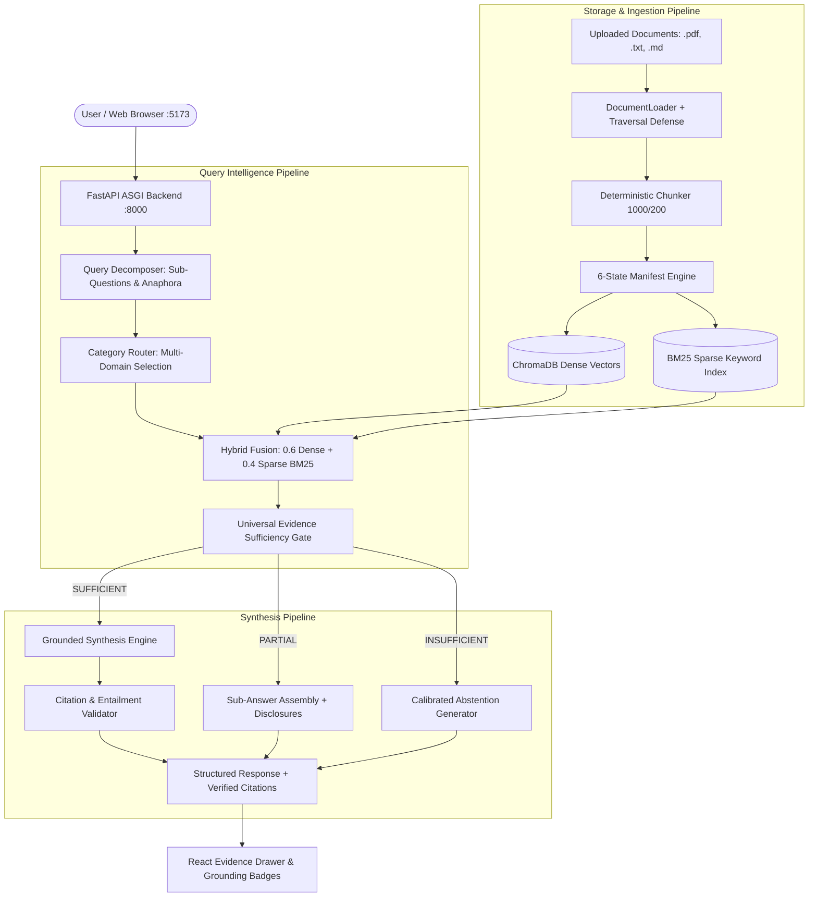

# System Architecture — Customer Support Intelligence Platform

**Release Version:** `v1.0.0-rc1`  
**Classification:** Controlled Pilot Ready  
**Date:** November 16, 2026  

---

## 1. Architecture Overview

The **Customer Support Intelligence Assistant / General-Purpose Document Intelligence Platform** is built on a decoupled, service-oriented architecture comprising an asynchronous **FastAPI backend** and a modern **React 18 / TypeScript frontend**.

The architecture prioritizes evidence grounding, multi-source context fusion, query decomposition, and explicit abstention over speculative generation.



---

## 2. Technology Stack & Component Map

| Layer | Technologies | Primary Responsibilities |
|---|---|---|
| **Frontend UI** | React 18.3, TypeScript 5.6, Vite 6.4, Tailwind CSS 3.4, Radix UI | User interaction, chat timeline, evidence badges, sliding Evidence Drawer, feedback modal. |
| **Backend Gateway** | FastAPI 0.100+, Python 3.10–3.13, Pydantic v2, Uvicorn | REST routing, dependency injection, CORS handling, request validation, error formatting. |
| **Dense Retrieval** | ChromaDB 0.4+, Sentence Transformers (`all-MiniLM-L6-v2`) | Semantic embedding generation (384-d cosine space), nearest-neighbor vector search. |
| **Sparse Retrieval** | Rank-BM25 (BM25Okapi) | Exact keyword matching for technical terms, model numbers, and error codes. |
| **Hybrid Fusion** | Reciprocal Rank Fusion (RRF) / Linear Combination | Scores weighted at $\alpha = 0.6$ dense, $1 - \alpha = 0.4$ sparse. |
| **Sufficiency & Gating** | Custom Heuristic Engine (`universal_evidence_sufficiency.py`) | Entity-aspect co-occurrence check, empirical similarity floor, 4-class status output. |
| **Query Decomposition** | Regex & Rule-Based Decomposer (`query_decomposer.py`) | Multi-clause conjunction splitting, comparative query separation, pronoun anaphora. |
| **Citation Verification** | Deterministic Validator (`citation_validator.py`) | Chunk ID confirmation, source metadata integrity, claim-level passage correspondence. |
| **Synthesis Execution** | Local Deterministic Synthesizer / Remote Colab LLM | Grounded Markdown answer generation; remote Mistral-7B-Instruct-v0.3 client. |

---

## 3. Subsystem Deep Dives

### 3.1 Document Ingestion & 6-State Lifecycle
The ingestion service enforces strict boundary controls before any document is indexed:
1. **Path Traversal Defense:** Sanitizes directory escape sequences (`..`, `/`, `\`); raw traversal attempts are rejected with HTTP 400.
2. **File Size Ceiling:** Rejects files exceeding 10 MB with HTTP 413.
3. **Format & Signature Check:** Verifies PDF magic bytes (`%PDF-`) and valid UTF-8 text encoding.
4. **Lifecycle State Machine:**
   - `uploaded` -> `processed` -> `pending_index` -> `indexed` (the **only** searchable state) -> `indexing_failed` -> `deleted`.
   - **Searchability Gating:** An uploaded document enters `pending_index` and cannot be retrieved in user queries until explicitly indexed via `POST /api/v1/documents/{id}/index`.

### 3.2 Query Decomposition & Anaphora Resolution
When a query contains multiple clauses (e.g., *"What is the print resolution of the ProX-400 and what is its retail price on Amazon?"*):
1. **Conjunction Detection:** Detects conjunction markers (`and`, `as well as`, `also`, `along with`).
2. **Comparative Pattern Matching:** Detects comparative queries (`Compare X and Y on [aspects]`).
3. **Pronoun Anaphora:** Resolves pronouns (`it`, `its`, `this`) in trailing clauses to the leading entity (`ProX-400`).
4. **Sub-Question Independence:** Each sub-question is queried through the hybrid retriever and evaluated against the evidence gate independently.

### 3.3 Universal Evidence Sufficiency Gate
Rather than assuming that any retrieved chunk is sufficient to answer a query:
- **Empirical Similarity Floor:** Evaluates top retrieval similarity against a calibrated floor ($0.280$ for general questions, $0.350$ for aspect-specific questions).
- **Entity-Aspect Verification:** Verifies that both the entity identifier (e.g. `ProX-400`) and the requested aspect (e.g. `resolution`, `duty cycle`, `warranty`) co-occur in the retrieved evidence text.
- **Out-of-Scope Predicate Defense:** Detects unsupported predicates (e.g. Amazon/eBay retail prices, unauthorized internal disassemblies, cryptographic credentials, unindexed foreign facilities) and routes them to abstention.
- **4-Class Status:**
  - `SUFFICIENT`: Evidence supports all query clauses.
  - `PARTIAL`: Evidence supports a subset of clauses; missing clauses are explicitly disclosed.
  - `INSUFFICIENT`: Evidence absent or irrelevant; formal abstention is generated.
  - `UNCERTAIN`: Ambiguous evidence triggering human review.

### 3.4 Synthesis Execution Paths

```
                     [ Query Execution ]
                              │
               Is Remote Colab Tunnel Active?
                     /                \
                   YES                 NO
                   /                    \
       [ Remote Mistral-7B ]    [ Local Grounded Engine ]
       - 4-bit NF4 quantized    - Deterministic synthesis
       - Natural language flow  - Verbatim excerpt assembly
       - Remote GPU inference   - Zero external dependency
```

- **Local Grounded Synthesis (Verified Default):** Operates completely offline without external API costs or discrete GPU requirements. Assembles verified excerpts into structured Markdown sections (Executive Summary, Technical Specifications, Missing Information & Limitations, Verified Citations).
- **Remote Colab LLM (Optional Integration):** Connects to an instruction-tuned `mistralai/Mistral-7B-Instruct-v0.3` model hosted on Google Colab (T4 GPU) via an authenticated Cloudflare tunnel, using Multi-Context Prompting to produce fluent responses bounded by retrieved context.

---

## 4. Implemented vs Conceptual Capabilities

| Capability | Status | Implementation Details |
|---|---|---|
| **Hybrid Retrieval (Dense + Sparse)** | Implemented | ChromaDB vector search + BM25Okapi with Reciprocal Rank Fusion. |
| **Evidence Sufficiency Gate** | Implemented | Automated heuristic co-occurrence and similarity floor evaluation. |
| **Query Decomposition** | Implemented | Conjunction splitting, comparative detection, pronoun anaphora. |
| **Local Deterministic Synthesis** | Implemented | Offline, zero-cost, citation-grounded response generation. |
| **Remote Colab Inference Client** | Implemented | ASGI client supporting remote Mistral-7B via authenticated tunnel. |
| **React 18 Evidence Drawer** | Implemented | Sliding drawer displaying verbatim text, chunk ID, and score. |
| **Dynamic Semantic Graph RAG** | Conceptual | Knowledge-graph triple extraction across cross-document links (future work). |
| **Fine-Tuned Embedder** | Conceptual | Domain-adapted contrastive fine-tuning for printer hardware (future work). |
| **Automated Formal Logic Proofs** | Conceptual | Mathematical theorem proving of factual entailment (future work). |
