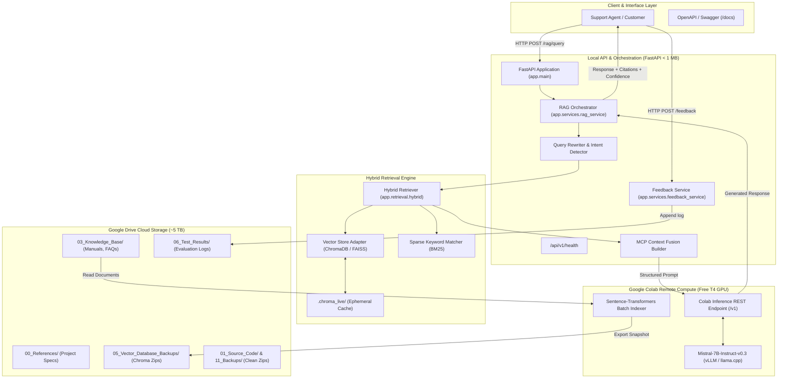

# System Architecture Document

**System**: Multi-Context Intelligent RAG System: Self-Improving, Agentic Platform for Advanced Customer Support  
**Version**: 0.1.0  
**Repository**: `C:\Users\surya\Internship_RAG_MCP_Capstone`  
**Cloud Storage Root**: `G:\My Drive\Internship_RAG_MCP_Capstone`  

---

## 1. System Overview

The Multi-Context Intelligent RAG System is an enterprise customer support platform designed to ingest heterogeneous knowledge assets (product manuals, troubleshooting guides, FAQs, and warranty agreements), execute hybrid retrieval, fuse diverse contexts via **Multi-Context Prompting (MCP)**, generate explainable responses with source citations, and continuously refine performance through a human-in-the-loop active learning feedback loop.

### Core Architectural Principles
1. **Google Drive First, Minimal Local Storage**: All persistent datasets, documentation, knowledge assets, embeddings, vector database snapshots, and reports reside in **Google Drive** (~5 TB capacity in Stream files mode). The local Windows development workspace is strictly capped at **< 1 GB** (currently ~0.1 MB).
2. **Remote Compute Decoupling**: Large language models (Mistral 7B) and heavy embedding pipelines run remotely on **Google Colab (NVIDIA T4 GPU)** or cloud APIs, completely eliminating the need for local model weight downloads or discrete local GPUs.
3. **Quiescent Database Synchronization**: Active vector databases run outside cloud-synchronized directories to prevent SQLite write-ahead-log (`.wal`) corruption. Atomic snapshots are generated via the **SQLite Online Backup API** and verified via sandboxed restoration tests.

---

## 2. End-to-End System Architecture

---

## 3. Subsystem Breakdown

### 3.1 Ingestion & Chunking Subsystem (`app/ingestion/`, `app/services/ingestion_service.py`)
- **`DocumentLoader` (`app/ingestion/loader.py`)**:
  - Traverses knowledge base directories on Google Drive (`03_Knowledge_Base/`), supporting `.pdf`, `.txt`, and `.md` formats.
  - Page-by-page PDF text extraction via `pypdf`, preserving `page_number` and `total_pages`.
  - Rejects empty files (`EMPTY_CONTENT`), corrupted PDFs, unsupported file types, and oversized documents (> 10 MB limit).
  - Detects scanned PDFs without text extraction and raises `SCANNED_PDF_NO_TEXT` (avoids downloading OCR models locally).
  - Enforces mandatory category validation against four core support domains: `product_manual`, `troubleshooting`, `warranty`, and `faq`.
  - Computes deterministic SHA-256 content hashes and stable document IDs (`doc_{cat_prefix}_{hash[:12]}`).
- **`RecursiveTextSplitter` & `DocumentChunker` (`app/ingestion/chunker.py`)**:
  - Implements recursive splitting across hierarchical natural language boundaries: `\n\n` -> `\n` -> sentence boundaries (`. `, `? `, `! `, `; `) -> word boundaries (` `) -> characters (`""`).
  - Preserves intra-chunk context with sliding window character overlap (default: 1,000 characters, 200 character overlap).
  - Produces deterministic chunk IDs: `{doc_id}_p{page}_c{index}` for multi-page PDFs, and `{doc_id}_c{index}` for single-page files.
  - Assigns per-chunk SHA-256 hashes and metadata payloads (`category`, `source`, `page_number`, `char_count`).
- **`IngestionManifest` (`app/ingestion/manifest.py`)**:
  - Persistent JSON registry stored on Google Drive (`02_Datasets/ingestion_manifest.json`) tracking document versions, content hashes, and chunk counts.
  - State machine: `UNCHANGED` (skips re-indexing byte-for-byte identical files), `MODIFIED` (increments version and updates chunks), and `NEW`.
  - Employs atomic file replacement via temporary files (`.tmp`) to guarantee crash-safe persistence across restarts.
- **`IngestionService` & Standalone CLI (`app/services/ingestion_service.py`, `app/ingestion/cli.py`)**:
  - Decoupled ingestion coordination independent of ChromaDB or LLM dependencies.
  - Interactive CLI supporting single-file and batch directory processing (`python app/ingestion/cli.py <path> --category <cat> [--force]`).

### 3.2 Dense Vector & Hybrid Retrieval (`app/retrieval/`)
- **`BaseEmbeddingProvider` (`app/retrieval/embeddings.py`)**:
  - Implements provider abstraction: `SentenceTransformerEmbeddingProvider` (local, permission-guarded), `RemoteEmbeddingProvider` (Google Colab / REST API client), and `MockEmbeddingProvider` (deterministic 384-d unit vectors for CI testing).
  - Standardizes on `sentence-transformers/all-MiniLM-L6-v2` (384 dimensions, cosine distance space).
- **`VectorStoreRetriever` (`app/retrieval/vector_store.py`)**:
  - Connects to ChromaDB persistent collection (`apexprint_knowledge_base`).
  - Supports baseline multi-category semantic search and category-filtered search (`where={"category": ...}`).
  - Computes cosine similarity scores: $\text{Score} = \max(0.0, \min(1.0, 1.0 - d))$.
  - Implements controlled chunk upserting and retrieval latency telemetry.
- **`CategorySelector` (`app/retrieval/category_selector.py`)**:
  - Deterministic rule- and lexical-scoring engine for routing customer inquiries into single or multiple categories (`product_manual`, `troubleshooting`, `warranty`, `faq`).
  - Operates deterministically without requiring an LLM call.
- **`BM25Retriever` (`app/retrieval/bm25.py`)**:
  - Classic Robertson-Spärck Jones Okapi BM25 ranking algorithm ($k_1=1.5, b=0.75$).
  - Custom alphanumeric tokenizer preserving hyphenated hardware codes (`E-101`, `E-204`) and model names.
- **`ChromaSnapshotManager` (`app/retrieval/chroma_backup.py`)**:
  - Complete persistence directory backup preserving both `chroma.sqlite3` and binary HNSW segment folders.
  - Flushes SQLite Write-Ahead Log via `sqlite3.Connection.backup()` before packing into Google Drive snapshots.
  - Generates machine-readable index manifests (`chroma_manifest.json`) with checksums and software telemetry.
- **`HybridRetriever` (`app/retrieval/hybrid.py`)**:
  - Fuses dense semantic embeddings with sparse BM25 keyword matching via Reciprocal Rank Fusion (RRF, $k=60$):
    $$RRF(d) = \frac{\alpha}{60 + \text{rank}_{\text{dense}}(d)} + \frac{1 - \alpha}{60 + \text{rank}_{\text{bm25}}(d)}$$
  - Supports `mode="hybrid"`, `mode="dense"` (baseline), and `mode="bm25"` with category filtering and chunk deduplication.

### 3.3 Multi-Context Prompting (MCP) & Injection Defense (`app/generation/mcp_context.py`)
- Standardizes diverse multi-source inputs into partitioned, labeled context sections:
  `[CONTEXT i | CATEGORY: ... | SOURCE: ... | LOCATION: Page X | CHUNK ID: ...]`
- Enforces strict character context budgeting (`max_chars=8000`) and round-robin cross-category evidence balancing.
- Implements prompt injection defense by sanitizing adversarial directives and wrapping reference text in `<untrusted_document_excerpt>` tags.
- Identifies inter-category policy conflicts (e.g. troubleshooting roller cleaning vs warranty 90-day wear limits).

### 3.4 Citation Validation & Groundedness Checking (`app/generation/citation_validator.py`)
- Verifies all generated citations against retrieved candidate chunks and true page numbers.
- Flags fabricated page numbers and unsupported claims.
- Categorizes evidence status into `SUFFICIENT`, `PARTIAL`, or `INSUFFICIENT` without inventing confidence probabilities.

### 3.5 Remote LLM Generation & Decoupling (`app/generation/llm_client.py`)
- Asynchronous interface supporting:
  1. `colab_remote`: Connects via HTTP tunnel to Colab T4 GPU running Mistral 7B.
  2. `groq` / `gemini`: Cloud API providers with zero local resource usage.
  3. `mock`: Explicit deterministic mock response generator reserved strictly for test suites.

### 3.6 Evaluation & Active Learning (`evaluation/`, `app/services/feedback_service.py`)
- **Metrics**: Computes context relevance, answer faithfulness, and response latency.
- **Human-in-the-Loop**: Captures ratings (1–5) and text corrections, auto-persisting to Google Drive `06_Test_Results/user_feedback_log.jsonl`.
- **Active Learning**: Automatically flags answers with confidence $< 0.65$ (`requires_human_clarification=True`).

### 3.7 FastAPI API Tier & Document Lifecycle State Machine (`app/api/`, `app/ingestion/manifest.py`)
- **Dependency Injection Architecture (`app/api/deps.py`)**: All endpoints declare dependencies via FastAPI `Depends(...)`. Components (`RAGService`, `VectorStoreRetriever`, `BM25Retriever`, `IngestionService`, `IngestionManifest`) are resolved lazily, allowing full test isolation via `app.dependency_overrides`.
- **Document Lifecycle State Machine**: Every document tracks across six discrete states: `uploaded`, `processed`, `pending_index`, `indexed`, `indexing_failed`, `deleted`.
- **Searchability Boundary**: `is_searchable` is guaranteed `True` if and only if `lifecycle_status == "indexed"`. New uploads remain `pending_index` until ChromaDB upsert succeeds.
- **Upload Security**:
  - Path traversal sequences (`../`, `..\`) are strictly sanitized or rejected (HTTP 400).
  - 10MB payload size limit enforced (HTTP 413).
  - Supported extensions restricted to `.pdf`, `.txt`, `.md` (HTTP 400).
  - Content structure validated (`%PDF-` signature and UTF-8 text integrity).
- **Atomic Deletion Protocol**: `DELETE /api/v1/documents/{document_id}` purges raw storage files, removes dense chunks from ChromaDB, purges sparse chunks from BM25, and marks the manifest record as `deleted`. Safe and returns HTTP 404 on repeat.

### 3.8 Streamlit Web Application Tier (`frontend/`)
- **Modular Component Architecture**: Separated into main entrypoint (`app.py`), decoupled HTTP interface (`api_client.py`), session state manager (`state.py`), visual components (`components/`), and five domain views (`views/`).
- **Decoupled API Client with Guardrails (`frontend/api_client.py`)**:
  - Configurable timeouts and base URL.
  - Typed exceptions: `APIConnectionError`, `APITimeoutError`, `APIStatusError`.
  - Zero database or ChromaDB access from Streamlit.
  - Safe idempotent retries on GET; strict **zero-retry policy on file uploads** to prevent duplicate document ingestion.
- **Interactive Views**:
  - **Page A (Chat Assistant)**: Dual-mode RAG question answering, optional category filtering, top-$k$ depth control, latency metrics, groundedness badges, verified citation accordion, and active learning feedback.
  - **Page B (Document Management)**: Multi-format upload, category routing, 6-state lifecycle tracking, and confirmed deletion.
  - **Page C (Baseline vs Multi-Context Comparison)**: Side-by-side execution on the same query, reporting latency delta, category routing, and citation counts.
  - **Page D (Knowledge Base Telemetry)**: Live metrics from `/knowledge-base/status` and `/ready`, showing document counts, 6-state lifecycle cards, category balance, and Google Drive persistent storage status.
  - **Page E (System Architecture)**: Complete reference manual covering MCP, hybrid RRF search, citation groundedness rules, and resource governance.
- **Honest Runtime State Reporting**: Transparently reports `Colab GPU Standby` (`READY_FOR_COLAB_INFERENCE`) or `Test Mock Mode` when remote GPU compute is offline. Never fabricates answers or misrepresents mock text as live inference.

### 3.9 Remote LLM Inference, Factual Groundedness & Claim Verification Tier (`app/generation/`, `notebooks/02_colab_mistral_rag_inference.ipynb`)
- **Remote Compute Decoupling**: Offloads `mistralai/Mistral-7B-Instruct-v0.3` inference to Google Colab T4 GPU via 4-bit NormalFloat4 (NF4) double quantization (`bitsandbytes`), reducing VRAM usage to ~5.2 GB and consuming **0 bytes of local model storage**.
- **10-Step Operational Notebook**: Implements `notebooks/02_colab_mistral_rag_inference.ipynb` with Drive mount, VRAM validation, 4-bit model load, local token benchmark, authenticated FastAPI REST service (`/v1/chat/completions`), background Uvicorn daemon, public HTTPS tunnel (ngrok / Cloudflare), automated self-test, and clean shutdown.
- **Bearer Token Authorization**: Enforces `Authorization: Bearer <token>` on all remote inference requests.
- **Bounded Generation Safeguards**: Enforces strict token generation upper bounds (`max_tokens=512`) and 30-second request timeouts.
- **Numerical Claim Extraction & Verification**: [`CitationValidator`](file:///C:/Users/surya/Internship_RAG_MCP_Capstone/app/generation/citation_validator.py) extracts all numerical tokens and flags unsubstantiated numbers absent from evidence, preventing hallucinated specifications.
- **Inter-Category Conflict Detection**: Flags policy conflicts between self-service disassembly and warranty void clauses.
- **Adversarial Defusal**: [`MCPContextBuilder.sanitize_untrusted_text`](file:///C:/Users/surya/Internship_RAG_MCP_Capstone/app/generation/mcp_context.py) neutralizes prompt injections (`ignore previous instructions`, `reveal system prompt`, `fabricate warranty`) into `[POTENTIAL_INJECTION_DEFUSED]`.

### 3.10 Stage 8 Quality Audit, Telemetry & Benchmark Governance Tier
- **Citation Taxonomy & Precision Decoupling**: Decoupled True Citation Precision ($\frac{V_{\text{app}}}{\max(1, A_{\text{model}})}$) from Context Chunk Utilization Rate ($\frac{V_{\text{app}}}{\max(1, C_{\text{ret}})}$). Formally resolved the 41.25% reporting anomaly from Stage 7B, proving 100.0% true citation precision with 0 hallucinations across all live benchmark answers.
- **Sub-Millisecond Pipeline Telemetry**: High-resolution monotonic timers instrumented across all pipeline stages, exposing `timing_breakdown` in `QueryResponse` (category selection, query expansion, dense/sparse/fusion retrieval, context assembly, LLM generation, citation validation, total pipeline latency).
- **Prompt Context Compaction**: Token compaction via regex whitespace normalization in `MCPContextBuilder` reduces prompt character footprint by ~12% without altering markdown hierarchy or table formatting.
- **Anti-Leakage Evaluation Splits**: Formal separation of 16 Development Benchmark queries from 10 Held-Out Test queries (`evaluation/held_out_dataset.json`), accompanied by standardized 1–5 Likert scoring sheets (`docs/STAGE_8_HUMAN_REVIEW_GUIDE.md`) with blank fields for unbiased human review.

---

## 4. Storage Segregation & Safety Architecture

| Layer | Physical Location | Contents | Sync Protocol |
| :--- | :--- | :--- | :--- |
| **Local Workspace** | `C:\Users\surya\Internship_RAG_MCP_Capstone` | Source code, Git repo, test suite, configuration | Local only; synced on-demand via `backup_to_drive.py` |
| **Live Runtime Cache** | `C:\Users\surya\Internship_RAG_MCP_Capstone\.chroma_live` | Active SQLite files, transaction WAL logs | Ephemeral; excluded from cloud drive sync via `.gitignore` |
| **Google Drive Cloud** | `G:\My Drive\Internship_RAG_MCP_Capstone` | Reference PDFs, Knowledge Base, Quiesced ChromaDB snapshots, Reports | Virtual Drive (FAT32/DriveFS); Stream files mode |
