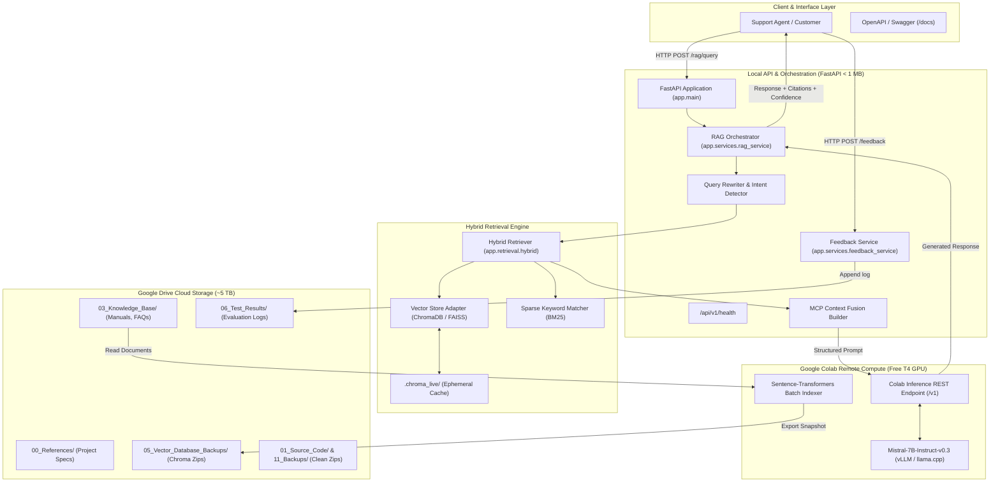

# System Architecture Document

**System**: Multi-Context Intelligent RAG System: Self-Improving, Agentic Platform for Advanced Customer Support  
**Version**: 0.1.0  
**Repository**: `C:\Users\surya\Internship_RAG_MCP_Capstone`  
**Cloud Storage Root**: `G:\My Drive\Internship_RAG_MCP_Capstone`  

---

## 1. System Overview

The Multi-Context Intelligent RAG System is an enterprise customer support platform designed to ingest heterogeneous knowledge assets (product manuals, troubleshooting guides, FAQs, and warranty agreements), execute hybrid retrieval, fuse diverse contexts via **Multi-Context Prompting (MCP)**, generate explainable responses with source citations, and continuously refine performance through a human-in-the-loop active learning feedback loop.

### Core Architectural Principles
1. **Google Drive First, Minimal Local Storage**: All persistent datasets, documentation, knowledge assets, embeddings, vector database snapshots, and reports reside in **Google Drive** (~5 TB capacity in Stream files mode). The local Windows development workspace is strictly capped at **< 1 GB** (currently ~0.1 MB).
2. **Remote Compute Decoupling**: Large language models (Mistral 7B) and heavy embedding pipelines run remotely on **Google Colab (NVIDIA T4 GPU)** or cloud APIs, completely eliminating the need for local model weight downloads or discrete local GPUs.
3. **Quiescent Database Synchronization**: Active vector databases run outside cloud-synchronized directories to prevent SQLite write-ahead-log (`.wal`) corruption. Atomic snapshots are generated via the **SQLite Online Backup API** and verified via sandboxed restoration tests.

---

## 2. End-to-End System Architecture

---

## 3. Subsystem Breakdown

### 3.1 Ingestion & Chunking (`app/ingestion/`)
- **`DocumentLoader`**: Traverses knowledge base directories on Google Drive (`03_Knowledge_Base/`), parsing `.txt`, `.md`, `.json`, `.csv`, and `.pdf` files.
- **`DocumentChunker`**: Executes character and token-level chunking with configurable overlap (default: 500 characters, 50-character overlap) while preserving source metadata, category, and chunk indices.

### 3.2 Hybrid Retrieval (`app/retrieval/`)
- **Dense Vector Search**: Connects to ChromaDB persistent collection.
- **Sparse Keyword Search**: Evaluates exact term overlap (BM25 proxy).
- **Reciprocal Rank / Linear Score Fusion**: Weighted score calculation:
  $$\text{Score}_{\text{hybrid}} = \alpha \cdot \text{Score}_{\text{dense}} + (1 - \alpha) \cdot \text{Score}_{\text{sparse}}$$
  (Default $\alpha = 0.60$).

### 3.3 Multi-Context Prompting (MCP) (`app/generation/mcp_context.py`)
- Standardizes diverse multi-source inputs into partitioned, labelled context sections:
  `[CONTEXT i | Category: CATEGORY | Source: FILENAME | Relevance: XX%]`
- Prevents cross-context hallucination and enables precise source attribution.

### 3.4 Remote LLM Generation & Decoupling (`app/generation/llm_client.py`)
- Provides an asynchronous interface supporting:
  1. `colab_remote`: Connects via HTTP tunnel to Colab T4 GPU running Mistral 7B.
  2. `groq` / `gemini`: Cloud API providers with zero local resource usage.
  3. `local_mock`: Deterministic mock response generator for offline execution and CI testing.

### 3.5 Evaluation & Active Learning (`evaluation/`, `app/services/feedback_service.py`)
- **Metrics**: Computes context relevance, answer faithfulness, and response latency.
- **Human-in-the-Loop**: Captures ratings (1–5) and text corrections, auto-persisting to Google Drive `06_Test_Results/user_feedback_log.jsonl`.
- **Active Learning**: Automatically flags answers with confidence $< 0.65$ (`requires_human_clarification=True`).

---

## 4. Storage Segregation & Safety Architecture

| Layer | Physical Location | Contents | Sync Protocol |
| :--- | :--- | :--- | :--- |
| **Local Workspace** | `C:\Users\surya\Internship_RAG_MCP_Capstone` | Source code, Git repo, test suite, configuration | Local only; synced on-demand via `backup_to_drive.py` |
| **Live Runtime Cache** | `C:\Users\surya\Internship_RAG_MCP_Capstone\.chroma_live` | Active SQLite files, transaction WAL logs | Ephemeral; excluded from cloud drive sync via `.gitignore` |
| **Google Drive Cloud** | `G:\My Drive\Internship_RAG_MCP_Capstone` | Reference PDFs, Knowledge Base, Quiesced ChromaDB snapshots, Reports | Virtual Drive (FAT32/DriveFS); Stream files mode |
