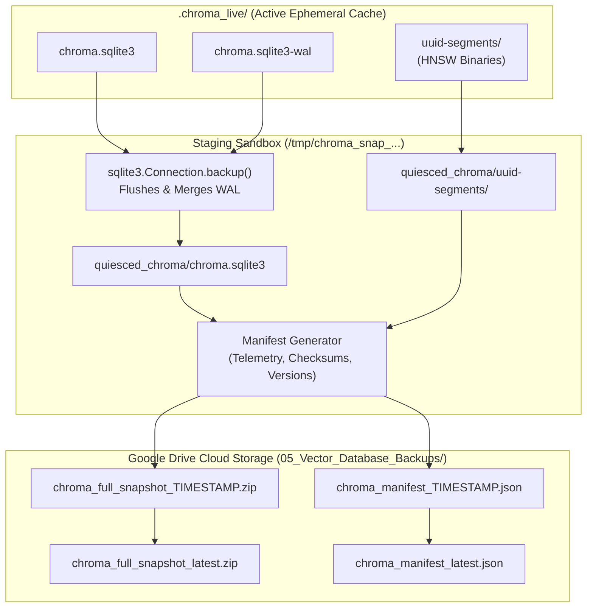

# ChromaDB Complete Persistence Backup & Restoration Protocol

**Project**: Customer Support Intelligence Assistant  
**Repository**: `C:\Users\surya\Internship_RAG_MCP_Capstone`  
**Cloud Storage**: `G:\My Drive\Internship_RAG_MCP_Capstone\05_Vector_Database_Backups\`  
**Date**: 2026-10-26  
**Status**: VERIFIED & AUTOMATED  

---

## 1. Architectural Problem: ChromaDB Persistence Beyond SQLite

In modern versions of ChromaDB, persistence involves two interdependent tiers:
1. **Relational Metadata Tier (`chroma.sqlite3`)**: Stores collection IDs, metadata dictionaries, document strings, and embedding mappings.
2. **Vector Index Tier (UUID Segment Folders)**: Stores binary HNSW graph structures, index metadata (`index_metadata.bin`), and vector buffers.

> [!CAUTION]
> Backing up only `chroma.sqlite3` is **critically insufficient**. Restoring a SQLite database without its corresponding segment UUID directories causes fatal vector lookup errors during similarity search.

Furthermore, active ChromaDB writes utilize SQLite's **Write-Ahead Log (`chroma.sqlite3-wal`)**. Direct file copying during active operations risks capturing torn pages or uncommitted transactions.

---

## 2. The Complete Snapshot Procedure

The snapshot procedure is automated via [`app/retrieval/chroma_backup.py`](file:///C:/Users/surya/Internship_RAG_MCP_Capstone/app/retrieval/chroma_backup.py) and integrated into [`scripts/backup_to_drive.py`](file:///C:/Users/surya/Internship_RAG_MCP_Capstone/scripts/backup_to_drive.py):



### Protocol Steps:
1. **Finish Indexing Operations**: Ensure all batch upserts are flushed.
2. **Quiesce SQLite State**: Use Python's native `sqlite3.Connection.backup()` to transfer the live WAL state into a standalone, uncorrupted SQLite database file. Live WAL and SHM journals are safely bypassed in the final archive.
3. **Copy All Segment Artifacts**: Copy all UUID segment subdirectories and binary index files verbatim.
4. **Package Archive**: Compress the quiesced directory into a `.zip` file on local disk first.
5. **Generate Index Manifest**: Calculate streaming SHA-256 checksum, chunk count, model info, and software versions.
6. **Atomic Upload to Google Drive**: Copy the zip and manifest to `05_Vector_Database_Backups/` and maintain `latest` symlink copies.
7. **Verify Readability**: Validate the file size and read byte streams to confirm cloud synchronization.

---

## 3. Machine-Readable Index Manifest Schema

Each backup archive is accompanied by a standardized manifest:

```json
{
  "manifest_version": "1.0",
  "collection_name": "apexprint_knowledge_base",
  "embedding_model": "sentence-transformers/all-MiniLM-L6-v2",
  "embedding_dimension": 384,
  "distance_metric": "cosine",
  "chunk_count": 21,
  "document_ids": [
    "doc_prod_8828edaf40d0",
    "doc_prod_51063b27f241",
    "doc_prod_87e13ad145a4",
    "doc_trou_ee29c06b48ed",
    "doc_trou_6515a19c8290",
    "doc_warr_2dc6b16efec0",
    "doc_warr_16f0708fca0e",
    "doc_faq_d8c75166d413",
    "doc_faq_ae953a11c979"
  ],
  "created_at_utc": "2026-10-26T13:20:00Z",
  "software_versions": {
    "python": "3.13.9",
    "chromadb": "1.5.9",
    "torch": "2.13.0+cpu"
  },
  "archive_filename": "chroma_full_snapshot_20261026_132000.zip",
  "archive_size_bytes": 142500,
  "archive_sha256": "e3b0c44298fc1c149afbf4c8996fb92427ae41e4649b934ca495991b7852b855"
}
```

---

## 4. Restoration and Verification Protocol

A backup is only considered valid once restored and queried:

```python
from app.retrieval.chroma_backup import ChromaSnapshotManager

manager = ChromaSnapshotManager()
result = manager.restore_snapshot(
    snapshot_zip_path="G:/My Drive/Internship_RAG_MCP_Capstone/05_Vector_Database_Backups/chroma_full_snapshot_latest.zip",
    target_directory="C:/Users/surya/Internship_RAG_MCP_Capstone/.chroma_live",
    expected_sha256="e3b0c44298fc1c149afbf4c8996fb92427ae41e4649b934ca495991b7852b855",
)

# Automated Checks Executed by restore_snapshot():
# 1. SHA-256 archive checksum match
# 2. Archive extraction completeness
# 3. SQLite PRAGMA integrity_check == "ok"
# 4. Table existence (embeddings, collections)
# 5. Chunk count consistency check
```

---

## 5. Verification Test Suite

Restoration integrity is verified automatically via:
- [`scripts/test_backup_and_restore.py`](file:///C:/Users/surya/Internship_RAG_MCP_Capstone/scripts/test_backup_and_restore.py): Simulates live WAL transactions and validates clean restoration.
- [`tests/test_retrieval.py`](file:///C:/Users/surya/Internship_RAG_MCP_Capstone/tests/test_retrieval.py): Tests `test_snapshot_manifest_and_quiescence`, `test_complete_database_restoration_and_integrity`, and `test_restoration_checksum_mismatch_raises_error`.
