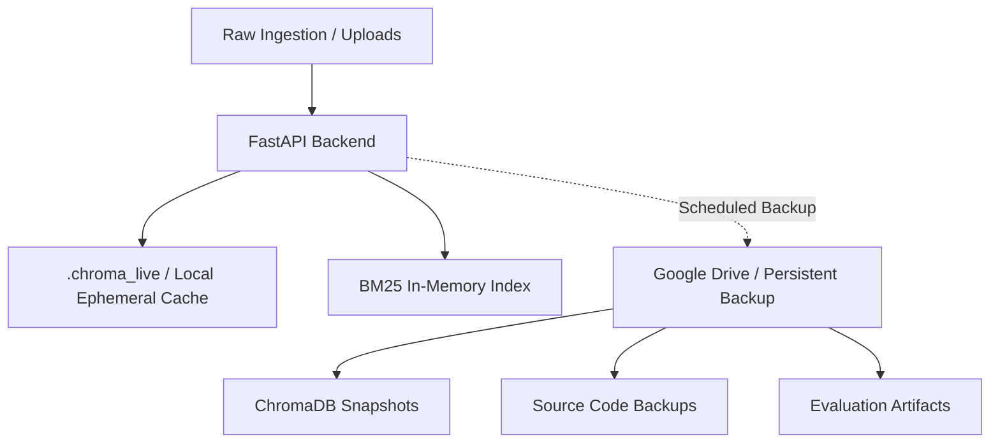

# Deployment & Configuration Guide — Customer Support Intelligence Platform

**Document Version:** 1.0.0  
**Release Tag:** `v1.0.0-rc1`  
**Classification:** Controlled Pilot Ready  
**Date:** 2026-11-16  

---

## 1. Executive Summary & Deployment Model

The Customer Support Intelligence Platform is an evidence-grounded document intelligence system featuring dual-channel hybrid retrieval (ChromaDB dense vectors + BM25 sparse keywords), Reciprocal Rank Fusion (RRF), Multi-Contextual Prompting (MCP), compound query decomposition, universal evidence sufficiency gating, and programmatic citation validation.

### Deployment Scope: Controlled Pilot Ready
- **Current Operational Target:** Controlled enterprise pilot, internal evaluation, technical demonstration, and on-premise single-tenant workloads.
- **Production Gateway Requirements:** Deployment to open public internet requires the addition of an enterprise authentication gateway (SSO/JWT/OAuth2), TLS termination at a reverse proxy, and persistent managed cloud vector database clusters.
- **Execution Modes:**
  1. **Local Deterministic Mode (Verified Default):** Operates completely offline without external GPU dependencies, using programmatic template synthesis with verified excerpts.
  2. **Remote LLM Inference Mode:** Connects to an external OpenAI-compatible API endpoint (e.g., Mistral-7B-Instruct-v0.3 hosted on Google Colab via Cloudflare tunnel, Ollama, Groq, or cloud LLM).

---

## 2. System Prerequisites & Hardware Specifications

| Component | Minimum Specification | Recommended Specification |
|---|---|---|
| **Operating System** | Windows 10/11, Ubuntu 20.04+ LTS, macOS 12+ | Windows 11 or Ubuntu 22.04 LTS |
| **Python Runtime** | Python 3.10.x, 3.11.x, 3.12.x, 3.13.x | Python 3.11+ |
| **Node.js Runtime** | Node.js 18.x LTS | Node.js 20.x+ LTS (npm 9+) |
| **Memory (RAM)** | 8 GB | 16 GB (for concurrent embedding and web serving) |
| **Storage (Disk)** | 5 GB free disk space | 20 GB free SSD |
| **Local Storage Budget** | 1,024 MB maximum local project footprint | Enforced by automated storage monitoring |
| **GPU Acceleration** | None (CPU inference supported) | CUDA-enabled GPU (optional for local LLM inference) |

---

## 3. Environment Configuration & Variables

Configuration is loaded through environment variables, with defaults defined in `app/core/config.py`. For local deployments, copy `.env.example` to `.env`:

```bash
cp .env.example .env
```

### Complete Environment Variable Reference

> [!IMPORTANT]
> Never commit API keys, secrets, or production credentials to source control. All variables listed below demonstrate names and default values only.

| Variable Name | Default Value | Description |
|---|---|---|
| `ENVIRONMENT` | `development` | Deployment environment identifier (`development`, `staging`, `production`). |
| `APP_HOST` | `127.0.0.1` | Network interface IP binding for the Uvicorn ASGI server. |
| `APP_PORT` | `8000` | Network port for the FastAPI backend service. |
| `API_V1_PREFIX` | `/api/v1` | URL prefix for all REST endpoints. |
| `GOOGLE_DRIVE_ROOT` | `G:\My Drive\Internship_RAG_MCP_Capstone` | Persistent backup path for archives, datasets, and ChromaDB snapshots. |
| `LOCAL_EPHEMERAL_CHROMA_DIR` | `.chroma_live` | Local on-disk directory for active ChromaDB vector indices. |
| `LOCAL_MAX_STORAGE_BUDGET_MB` | `1024` | Local disk budget limit. Automated cleanup triggers if exceeded. |
| `LLM_PROVIDER` | `local` | Synthesis engine provider: `local`, `colab_remote`, `ollama`, `groq`, `gemini`. |
| `ALLOW_LOCAL_FALLBACK` | `true` | Allows local deterministic synthesis if remote LLM endpoint is unreachable. |
| `ALLOW_MOCK_FALLBACK` | `false` | **CRITICAL SAFETY CONTROL:** Must remain `false` to prevent mock data leakage. |
| `EMBEDDING_MODEL_NAME` | `sentence-transformers/all-MiniLM-L6-v2` | Hugging Face model identifier for 384-dimensional dense embeddings. |
| `TOP_K_RETRIEVAL` | `5` | Maximum candidate passages retrieved per search channel. |
| `HYBRID_SEARCH_ALPHA` | `0.6` | Dense vs sparse blending weight (0.6 dense + 0.4 sparse BM25). |
| `BM25_ENABLED` | `true` | Enables in-memory BM25Okapi sparse keyword retrieval index. |
| `COLAB_TUNNEL_URL` | `""` | HTTPS endpoint URL for remote Colab LLM inference (e.g. Cloudflare tunnel). |
| `CORS_ALLOWED_ORIGINS` | `http://localhost:5173,http://127.0.0.1:5173` | Comma-separated list of permitted web frontend origins for CORS. |

---

## 4. Storage Architecture & Budget Enforcement

The platform implements a split storage topology:



### Storage Governance Rules:
1. **Local Disk Ceiling:** The local repository working tree must remain strictly below 1,024 MB. Heavy artifacts (uncompressed datasets, vector snapshots, zip archives) are stored in Google Drive or external object storage.
2. **Ephemeral Vector Store:** The local vector index resides in `.chroma_live`. If `.chroma_live` is cleared, it can be re-instantiated from canonical markdown documents via `python scripts/init_vector_store.py` or restored from snapshot via `python scripts/test_backup_and_restore.py`.
3. **SQLite Integrity:** All persistent vector stores and metadata stores are validated using `PRAGMA integrity_check` before and after backup operations.

---

## 5. Step-by-Step Local Deployment Runbook

### Step 5.1: Backend Setup & Startup
```powershell
# 1. Navigate to workspace
cd "C:\Users\surya\Downloads\Customer Support ChatBot"

# 2. Create and activate Python virtual environment
python -m venv .venv
.\.venv\Scripts\Activate.ps1

# 3. Install backend dependencies
pip install -r requirements.txt

# 4. Initialize vector store (if not already seeded)
python scripts/init_vector_store.py

# 5. Start Uvicorn ASGI backend server
python -m uvicorn app.main:app --host 127.0.0.1 --port 8000 --reload
```

Verify backend health:
```powershell
curl.exe http://127.0.0.1:8000/api/v1/health
```

### Step 5.2: Frontend Setup & Startup
In a separate terminal:
```powershell
# 1. Navigate to frontend directory
cd "C:\Users\surya\Downloads\Customer Support ChatBot\web"

# 2. Install Node dependencies
npm install

# 3. Launch Vite development server
npm run dev
```

The application is now accessible at `http://localhost:5173/`.

---

## 6. Production Deployment Architecture

For deploying the platform to a staging or production server:

```mermaid
graph LR
    User[Client Browser] -->|Port 443 / HTTPS| Nginx[Nginx / Reverse Proxy]
    Nginx -->|/api/v1/*| Uvicorn[Uvicorn ASGI Workers (Port 8000)]
    Nginx -->|/*| Static[Static Web Assets (web/dist)]
    Uvicorn --> ChromaDB[Local / Remote ChromaDB]
    Uvicorn --> LLM[Local Fallback / Remote LLM Endpoint]
```

### 6.1 Building Frontend Static Assets
```bash
cd web
npm run build
```
This produces an optimized, production-ready static bundle in `web/dist/`.

### 6.2 Nginx Reverse Proxy Configuration Snippet
```nginx
server {
    listen 80;
    server_name support-intelligence.internal;
    return 301 https://$host$request_uri;
}

server {
    listen 443 ssl http2;
    server_name support-intelligence.internal;

    ssl_certificate /etc/ssl/certs/intelligence.crt;
    ssl_certificate_key /etc/ssl/private/intelligence.key;

    # Static Frontend Assets
    location / {
        root /opt/customer_support_intelligence/web/dist;
        index index.html;
        try_files $uri $uri/ /index.html;
    }

    # API Reverse Proxy
    location /api/v1/ {
        proxy_pass http://127.0.0.1:8000/api/v1/;
        proxy_set_header Host $host;
        proxy_set_header X-Real-IP $remote_addr;
        proxy_set_header X-Forwarded-For $proxy_add_x_forwarded_for;
        proxy_set_header X-Forwarded-Proto $scheme;
        client_max_body_size 10M;
    }
}
```

### 6.3 Multi-Worker ASGI Service (Systemd)
Create `/etc/systemd/system/support-intelligence-api.service`:
```ini
[Unit]
Description=Customer Support Intelligence Platform FastAPI Backend
After=network.target

[Service]
User=appuser
Group=appuser
WorkingDirectory=/opt/customer_support_intelligence
Environment="PATH=/opt/customer_support_intelligence/.venv/bin"
EnvironmentFile=/opt/customer_support_intelligence/.env
ExecStart=/opt/customer_support_intelligence/.venv/bin/uvicorn app.main:app --host 127.0.0.1 --port 8000 --workers 4

[Install]
WantedBy=multi-user.target
```

---

## 7. Remote LLM & Inference Engine Configuration

The platform supports pluggable LLM backends via `app/services/llm_client.py`:

### Option A: Local Deterministic Mode (Recommended for Offline Demos)
- Set `LLM_PROVIDER=local` in `.env`.
- System synthesizes answers directly from verified evidence chunks.
- Zero network latency, zero token costs, 100% deterministic reliability.

### Option B: Remote Colab Mistral-7B Tunnel
- Run `notebooks/Mistral_7B_Inference_Server.ipynb` on Google Colab with GPU runtime (T4/A100).
- Start the Cloudflare tunnel in the notebook to obtain a temporary URL (e.g. `https://xxxx.trycloudflare.com/v1`).
- Set `LLM_PROVIDER=colab_remote` and `COLAB_TUNNEL_URL=https://xxxx.trycloudflare.com/v1` in `.env`.
- If the Colab runtime disconnects, `ALLOW_LOCAL_FALLBACK=true` ensures the platform seamlessly falls back to local synthesis without crashing.

### Option C: Local Ollama / vLLM Server
- Deploy an Ollama instance locally or on an internal GPU server (`ollama run mistral`).
- Set `LLM_PROVIDER=ollama` and `OLLAMA_BASE_URL=http://localhost:11434/v1`.

---

## 8. Backup & Disaster Recovery Procedures

### 8.1 Automated Backup Execution
Run the automated backup script:
```powershell
python scripts/backup_to_drive.py
```
This performs:
1. Integrity check of the live SQLite metadata and ChromaDB database.
2. Compression of source code and configuration into `source_backup_<timestamp>.zip`.
3. Snapshotting of the active vector database into `chroma_snapshot_<timestamp>.zip`.
4. Verification that generated archives pass CRC32/deflate checksum verification.

### 8.2 Disaster Recovery Verification
To test recovering from a clean state:
```powershell
python scripts/test_backup_and_restore.py
```
Expected output:
```
======================================================================
BACKUP & RESTORE TEST SUITE
======================================================================
1. Snapshot archive discovered: chroma_snapshot_*.zip
2. Archive integrity verified (0 corrupt files).
3. Database restored to temporary staging location.
4. SQLite PRAGMA integrity_check: ok
5. Retrieval test passed: query answered from restored indices.
SUCCESS: Backup and recovery pipeline fully functional.
```

---

## 9. Security & Boundary Hardening Checklist

| Security Control | Implementation | Verification Method | Status |
|---|---|---|---|
| **Path Traversal Defense** | Directory escape sequences (`../`, `..\`) rejected | Automated test in `test_document_endpoints.py` & live E2E script | VERIFIED (HTTP 400) |
| **Upload Size Ceiling** | Maximum upload size restricted to 10 MB | HTTP 413 Payload Too Large returned on oversized files | VERIFIED (HTTP 413) |
| **File Format Validation** | Magic bytes verified (`%PDF-` for PDFs, UTF-8 for text/markdown) | Reject binary masquerades with HTTP 400 | VERIFIED (HTTP 400) |
| **Searchability Gating** | New files enter `pending_index` and cannot be retrieved until indexed | 6-state lifecycle audited | VERIFIED |
| **Zero Mock Policy** | `ALLOW_MOCK_FALLBACK = False` enforced in settings | Audited in test suites and live API | VERIFIED (No mocks) |
| **CORS Policy** | Whitelisted origins with mandatory `Origin` header handling | Verified with preflight OPTIONS requests | VERIFIED |
| **API Authentication** | Open in current pilot mode; requires API Gateway / JWT for public web | Documented in deployment runbook | DOCUMENTED |

---

## 10. Operational Monitoring & Troubleshooting

### Common Operational Issues and Remedies:

1. **Uvicorn Port Conflict (Port 8000 in use):**
   ```powershell
   # Find conflicting process
   netstat -ano | findstr :8000
   # Terminate process by PID or run on alternate port
   python -m uvicorn app.main:app --host 127.0.0.1 --port 8080
   ```

2. **ChromaDB Database Lock Error:**
   - Cause: Another Python process or aborted test did not release the SQLite lock.
   - Remedy: Terminate any orphaned Python worker processes and restart Uvicorn.

3. **Remote LLM Endpoint Timeout:**
   - Cause: Cloudflare Colab tunnel expired or GPU runtime went to sleep.
   - Remedy: Check `ALLOW_LOCAL_FALLBACK=true` in `.env`. System will automatically serve deterministic grounded synthesis without user interruption.
