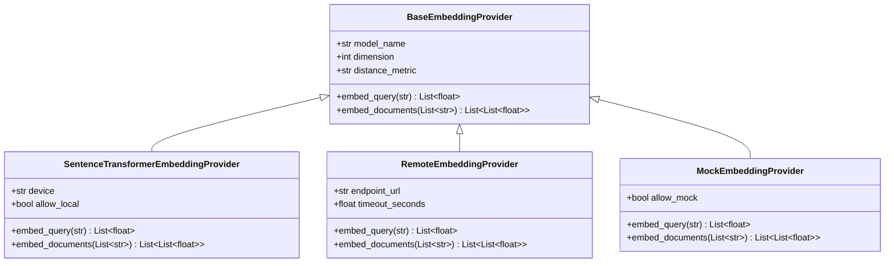

# Embedding Generation and Vector Store Specification

**Project**: Customer Support Intelligence Assistant (Multi-Context RAG System)  
**Repository**: `C:\Users\surya\Internship_RAG_MCP_Capstone`  
**Cloud Storage**: `G:\My Drive\Internship_RAG_MCP_Capstone`  
**Date**: 2026-10-26  
**Status**: VERIFIED & TESTED  

---

## 1. Embedding Model Specifications

The vector retrieval subsystem standardizes on `sentence-transformers/all-MiniLM-L6-v2` across all indexing and querying workflows.

| Attribute | Specification | Justification |
| :--- | :--- | :--- |
| **Model Name** | `sentence-transformers/all-MiniLM-L6-v2` | Fast, state-of-the-art semantic representation for technical customer support passages. |
| **Model Revision** | Canonical HuggingFace revision (`all-MiniLM-L6-v2`) | Deterministic weights across Google Colab and remote environments. |
| **Vector Dimension** | **384 dimensions** | Compact representation: high retrieval accuracy with minimal memory footprint (1.5 KB per chunk). |
| **Distance Metric** | **Cosine Distance** ($1.0 - \text{cosine similarity}$) | Optimal for comparing normalized variable-length customer queries to technical support chunks. |
| **Vector Normalization** | **L2-Normalized** ($\|v\|_2 = 1.0$) | Guarantees consistent distance calculations where inner product equals cosine similarity. |
| **Compute Location** | **Google Colab (NVIDIA T4 GPU / CPU fallback)** | **0 GB local model weight downloads** on developer machine. |

---

## 2. Embedding Provider Architecture

The embedding provider interface ([`app/retrieval/embeddings.py`](file:///C:/Users/surya/Internship_RAG_MCP_Capstone/app/retrieval/embeddings.py)) implements an extensible provider abstraction:



### Provider Responsibilities
1. **`SentenceTransformerEmbeddingProvider`**:
   - Executes local sentence-transformers inference.
   - Protected by `allow_local=False` default: raising `EmbeddingConfigurationError` to prevent accidental large downloads without user permission.
2. **`RemoteEmbeddingProvider`**:
   - Sends batch HTTP requests (`POST /v1/embeddings`) to Google Colab tunnel or API endpoints.
   - Request schema: `{"input": [...], "model": "sentence-transformers/all-MiniLM-L6-v2"}`.
   - Response parsing: parses OpenAI / TEI standard (`{"data": [{"embedding": [...]}]}`) or flat arrays.
   - Error handling: raises `EmbeddingConnectionError` on network refusal and `EmbeddingTimeoutError` on timeout.
3. **`MockEmbeddingProvider`**:
   - Strictly reserved for automated unit testing (`allow_mock=True` or `TEST_MODE=True`).
   - Generates deterministic 384-dimensional unit vectors derived from SHA-256 seed bytes.
   - Raises `MockEmbeddingForbiddenError` if invoked in non-test mode.

---

## 3. ChromaDB Collection Design

- **Collection Name**: `apexprint_knowledge_base`
- **HNSW Space Configuration**: `metadata={"hnsw:space": "cosine"}`
- **Persistence Location**: `.chroma_live/` (local ephemeral cache) or `/tmp/chroma_build/` (Colab ephemeral build)
- **Primary Persistent Backup**: `G:\My Drive\Internship_RAG_MCP_Capstone\05_Vector_Database_Backups\`

### Chunk Metadata Schema
ChromaDB requires flat, scalar metadata types. All metadata fields strictly conform to `str`, `int`, `float`, or `bool`:

```json
{
  "document_id": "doc_prod_87e13ad145a4",
  "chunk_id": "doc_prod_87e13ad145a4_c0000",
  "category": "product_manual",
  "filename": "apexprint_prox400_user_manual.md",
  "page_number": -1,
  "source": "apexprint_prox400_user_manual.md",
  "content_hash": "87e13ad145a4f58929d6990528df947609f87b52ea17af0a54f38127e5558764"
}
```
*Note: For single-page Markdown/TXT documents without discrete pages, `page_number` defaults to `-1` to ensure consistent scalar typing.*

---

## 4. Semantic Retrieval & Category Filtering

The vector retriever adapter ([`app/retrieval/vector_store.py`](file:///C:/Users/surya/Internship_RAG_MCP_Capstone/app/retrieval/vector_store.py)) executes vector similarity queries:

```python
retriever = VectorStoreRetriever(
    collection_name="apexprint_knowledge_base",
    embedding_provider=get_embedding_provider(),
)

# Baseline retrieval across all categories
results = retriever.retrieve("My printer cannot connect to Wi-Fi", top_k=5)

# Category-filtered retrieval (e.g., warranty only)
warranty_results = retriever.retrieve("Accidental liquid spill", top_k=3, category="warranty")
```

### Similarity Score Computation
ChromaDB returns cosine distance $d \in [0, 2]$. The retriever computes normalized cosine similarity score:
$$\text{Score} = \max(0.0, \min(1.0, 1.0 - d))$$

> [!IMPORTANT]
> Raw cosine similarity values reflect vector closeness in the embedding space. They are **never** represented as calibrated probabilities of factual correctness.
