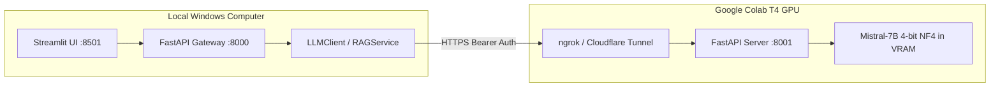

# Real LLM Inference Operator Guide: Google Colab GPU & Mistral-7B Service

This runbook guides operators through launching, securing, connecting, and tearing down the remote `mistralai/Mistral-7B-Instruct-v0.3` inference service on a free Google Colab NVIDIA T4 GPU.

---

## 1. Architectural Overview & Compute Governance

To maintain a **strict zero-local-model policy** on local developer machines (< 1 GB disk footprint), all heavy LLM inference is completely decoupled and offloaded to Google Colab GPU:



### Governance Principles
- **0 Bytes Local Model Downloads**: Model weights (~4.5 GB quantized) reside purely in Colab ephemeral memory.
- **Strict Authentication**: Every remote request requires a secret Bearer authorization token header (`Authorization: Bearer <token>`).
- **Bounded Compute**: Generation is capped at `max_tokens=512` with a 30-second request timeout to prevent GPU stalls.
- **Hardware Sizing**: Fits cleanly within Google Colab's standard 15 GB VRAM using 4-bit NF4 quantization (~5.2 GB allocated).

---

## 2. Prerequisites

1. **Google Account**: Access to [Google Colab](https://colab.research.google.com).
2. **Google Drive Sync**: Google Drive for desktop mounted at `G:\My Drive\Internship_RAG_MCP_Capstone`.
3. **Tunneling Token (Recommended)**: Free account on [ngrok.com](https://ngrok.com) for public HTTPS tunneling, or Cloudflare Tunnel (`cloudflared`).
4. **Hugging Face Account (Optional)**: If access to gated Mistral weights requires acceptance of terms.

---

## 3. Step-by-Step Colab Execution Runbook

Open [`notebooks/02_colab_mistral_rag_inference.ipynb`](file:///C:/Users/surya/Internship_RAG_MCP_Capstone/notebooks/02_colab_mistral_rag_inference.ipynb) in Google Colab and run each cell sequentially:

### Step 1: Mount Google Drive
Mounts `/content/drive` and validates access to knowledge base documents and backups.
```python
from google.colab import drive
drive.mount('/content/drive')
```

### Step 2: GPU Hardware Verification
Confirms NVIDIA T4 GPU availability and checks allocated VRAM:
```bash
!nvidia-smi
```

### Step 3: Package Installation
Installs lightweight inference dependencies:
```bash
!pip install -q --upgrade transformers accelerate bitsandbytes fastapi uvicorn pydantic pyngrok httpx
```

### Step 4: 4-Bit NF4 Model Loading
Loads `mistralai/Mistral-7B-Instruct-v0.3` using double quantization:
```python
from transformers import AutoTokenizer, AutoModelForCausalLM, BitsAndBytesConfig

bnb_config = BitsAndBytesConfig(
    load_in_4bit=True,
    bnb_4bit_quant_type="nf4",
    bnb_4bit_use_double_quant=True,
    bnb_4bit_compute_dtype=torch.float16,
)
model = AutoModelForCausalLM.from_pretrained(
    "mistralai/Mistral-7B-Instruct-v0.3",
    quantization_config=bnb_config,
    device_map="auto",
    torch_dtype=torch.float16,
)
```
*Telemetry Check*: VRAM allocated should read approximately `5.2 GB / 15.0 GB`.

### Step 5: Local Generation Benchmark
Runs a test prompt directly on the Colab instance to measure generation latency and throughput (typically 25–40 tokens/sec on T4).

### Step 6: Authenticated OpenAI REST Server Definition
Defines the FastAPI application exposing `/v1/models` and `/v1/chat/completions`:
- Configures Bearer token verification (`verify_auth`).
- Enforces strict upper bound on completion tokens (`max_tokens <= 1024`).

### Step 7: Launch Background Server
Starts Uvicorn in a background thread listening on port 8001:
```python
server_thread = threading.Thread(target=run_server, daemon=True)
server_thread.start()
```

### Step 8: Expose Public Tunnel
Generates a secure HTTPS tunnel endpoint:
```python
public_tunnel = ngrok.connect(8001)
print(f"COLAB_API_ENDPOINT={public_tunnel.public_url}/v1")
print(f"COLAB_API_KEY={INFERENCE_AUTH_TOKEN}")
```

### Step 9: End-to-End Self-Test
Validates that:
- Missing authorization returns `HTTP 401 Unauthorized`.
- Valid Bearer token returns `HTTP 200 OK` with JSON completion payload.

### Step 10: Safe Teardown
When finished, disconnect tunnels and flush CUDA memory:
```python
shutdown_inference_service()
```

---

## 4. Connecting Local Application to Colab Server

### Option A: Via Local `.env` Configuration
Add the tunnel URL and key to your local `.env` file:
```ini
LLM_PROVIDER=colab_remote
COLAB_API_ENDPOINT=https://your-ngrok-tunnel.ngrok-free.app/v1
COLAB_API_KEY=<your-private-session-token>
```
Restart the FastAPI backend (`python -m uvicorn app.main:app --port 8000`).

### Option B: Via Streamlit UI Sidebar
1. Navigate to `http://localhost:8501`.
2. In the Sidebar, locate the **Inference Settings** panel.
3. Paste your public tunnel endpoint into **Colab API Endpoint**.
4. Enter your secret token into **Colab API Key**.
5. The provider indicator will transition to **🟢 Colab GPU Active** (`ONLINE_COLAB_GPU`).

---

## 5. Offline Fallback & Simulation Safety

If the Colab server is offline or the tunnel expires:
- The system **never** silently falls back to fabricated facts in normal operation.
- In test environments, the system transparently reports `TEST_MOCK_MODE` or `READY_FOR_COLAB_INFERENCE`.
- The evaluation engine provides [`DeterministicGroundedSynthesizer`](file:///C:/Users/surya/Internship_RAG_MCP_Capstone/evaluation/stage7_evaluator.py) for offline verification, explicitly labeling all outputs as `SIMULATED_OFFLINE`.
