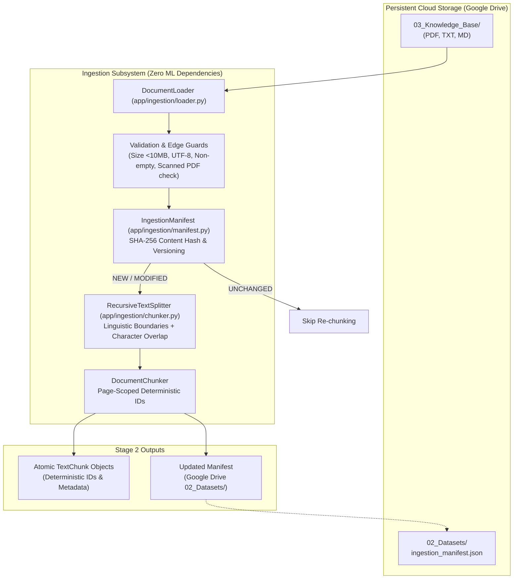

# Stage 2 Implementation Report: Knowledge Base Ingestion & Preprocessing

**Project**: Customer Support Intelligence Assistant (Multi-Context RAG System)  
**Repository**: `C:\Users\surya\Internship_RAG_MCP_Capstone`  
**Cloud Storage Root**: `G:\My Drive\Internship_RAG_MCP_Capstone`  
**Date**: 2026-10-26  
**Status**: COMPLETE (Verified & Passing 39/39 Tests)  

---

## 1. Executive Summary

Stage 2 establishes the end-to-end knowledge base ingestion and preprocessing pipeline for the Customer Support Intelligence Assistant. In accordance with strict development boundaries:
- Embeddings, vector database indexing, and LLM inference were **strictly deferred** to Stage 3.
- The pipeline parses **PDF**, **TXT**, and **Markdown** documents, extracts page-by-page text, validates content, performs recursive linguistic chunking, tracks document versions, and deduplicates files via a crash-safe manifest.
- A synthetic knowledge base covering a fictional enterprise printer family (**ApexPrint ProX-400** and **ColorWave 850**) was generated across 4 mandatory support categories and stored persistently on **Google Drive** (`03_Knowledge_Base/`).
- Incremental local storage was kept minimal: the entire local repository consumes **0.41 MB** (< 0.05% of the 1 GB development budget).
- The full test suite comprising **39 tests across 5 test modules** passed with zero failures.

---

## 2. Ingestion Pipeline Architecture



---

## 3. Supported File Types & Extraction Engineering

The document loader ([`app/ingestion/loader.py`](file:///C:/Users/surya/Internship_RAG_MCP_Capstone/app/ingestion/loader.py)) handles heterogeneous customer support documentation:

| Format | Parsing Engine | Boundary Preservation | Error Handling & Guardrails |
| :--- | :--- | :--- | :--- |
| **PDF (`.pdf`)** | `pypdf.PdfReader` | Page-by-page extraction (`DocumentPage`), page indexing (1-based) | Detects corrupted PDFs (`PdfStreamError`), empty PDFs, and scanned PDFs with no selectable text (`SCANNED_PDF_NO_TEXT`). Avoids downloading heavy local OCR models. |
| **Markdown (`.md`)** | Native UTF-8 stream | Preserves headings, tables, bullet points, and code blocks | Rejects empty files (`EMPTY_CONTENT`), oversized files (> 10 MB limit), and handles invalid encodings gracefully with fallback replacement. |
| **Text (`.txt`)** | Native UTF-8 stream | Line breaks and paragraph separation preserved | Validates mandatory categories (`product_manual`, `troubleshooting`, `warranty`, `faq`). |

### Document Object Schema
Every loaded document is encapsulated in a structured `Document` dataclass:
```python
class Document:
    document_id: str          # Format: doc_{cat_prefix}_{hash[:12]}
    filename: str             # e.g., "apexprint_prox400_user_manual.md"
    document_type: str         # "pdf", "md", or "txt"
    category: str              # product_manual, troubleshooting, warranty, faq
    content_hash: str          # SHA-256 of raw file bytes
    source: str                # Relative path or identifier
    content: str               # Full concatenated document text
    pages: List[DocumentPage]  # Page objects with 1-based page_number and text
    total_pages: int           # Total page count (1 for txt/md)
    ingestion_timestamp: str   # ISO 8601 UTC timestamp
    processing_status: str     # "SUCCESS" or error descriptor
    file_size_bytes: int       # Raw byte length
```

---

## 4. Chunking Strategy & Tradeoffs

The chunking subsystem ([`app/ingestion/chunker.py`](file:///C:/Users/surya/Internship_RAG_MCP_Capstone/app/ingestion/chunker.py)) implements `RecursiveTextSplitter` and `DocumentChunker`.

### Character vs. Token Chunking Analysis
| Parameter | Character-Based (Implemented) | Token-Based (TikToken / HuggingFace) |
| :--- | :--- | :--- |
| **Memory / RAM Footprint** | **0 MB** (Pure Python string slicing) | 50–200 MB (Requires loading tokenizer vocabularies) |
| **Model Independence** | **100% agnostic** (Works identically for Mistral, Gemini, Groq) | Tied to specific LLM tokenizer (BPE / WordPiece) |
| **Processing Speed** | **Microseconds** per document | Milliseconds per document |
| **Context Window Control** | Approximated via character ratio (~4 chars/token) | Exact token count matching context window |
| **Decision for Stage 2** | **Selected** — Aligns with strict 1.1 GB RAM constraint. | Deferred — Can be activated in Stage 3 if needed. |

### Chunk Configuration
- **Chunk Size**: `1,000` characters (approximately 250 tokens), ideal for self-contained customer support instructions.
- **Chunk Overlap**: `200` characters (approximately 50 tokens), preventing semantic fragmentation across boundaries.
- **Hierarchical Boundary Cascade**: `\n\n` (paragraphs) $\rightarrow$ `\n` (lines) $\rightarrow$ `[". ", "? ", "! ", "; "]` (sentences) $\rightarrow$ `" "` (words) $\rightarrow$ `""` (character fallback).

### Deterministic Chunk Identification & Attribution
- For multi-page PDFs: `{doc_id}_p{page_number}_c{chunk_index:04d}` (e.g., `doc_prod_51063b27f241_p1_c0000`).
- For single-page documents: `{doc_id}_c{chunk_index:04d}` (e.g., `doc_trou_ee29c06b48ed_c0001`).
- Each `TextChunk` contains its own SHA-256 hash, category, page number, and source filename for precise, explainable citations in RAG generation.

---

## 5. Duplicate Detection & Manifest Persistence

The deduplication engine ([`app/ingestion/manifest.py`](file:///C:/Users/surya/Internship_RAG_MCP_Capstone/app/ingestion/manifest.py)) maintains an `IngestionManifest` stored persistently on **Google Drive** (`02_Datasets/ingestion_manifest.json`):

1. **Byte-Level Content Hashing**: Computes SHA-256 hash of raw file contents before parsing.
2. **State Evaluation**:
   - `UNCHANGED`: Content hash matches existing record. Loading and chunking are skipped entirely, saving processing time and avoiding redundant downstream embeddings.
   - `MODIFIED`: Same filename and category but different content hash. Increments document `version` counter and updates metadata.
   - `NEW`: First time file has been seen. Registers file in registry and documents map.
3. **Crash-Safe Persistence**: Manifest saves write to a temporary file (`.tmp`) before calling `os.replace()`, preventing corruption if process is interrupted during I/O.
4. **Decoupled Architecture**: Ingestion operates completely independently of ChromaDB or LLM dependencies.

---

## 6. Synthetic Customer Support Knowledge Base

A multi-format, realistic customer support knowledge base was created for a fictional enterprise printer family (**ApexPrint ProX-400** and **ColorWave 850**) and saved to `G:\My Drive\Internship_RAG_MCP_Capstone\03_Knowledge_Base\`:

| Category | File Name | Format | Chunks | Content Scope |
| :--- | :--- | :--- | :---: | :--- |
| `product_manual` | `apexprint_prox400_user_manual.md` | MD | 2 | Hardware specs, dual-band Wi-Fi, 45 ppm speed, paper tray setup |
| `product_manual` | `apexprint_colorwave850_user_manual.md` | MD | 2 | Wide-format color inkjet, CMYK tanks, ICC calibration |
| `product_manual` | `apexprint_prox400_quick_spec_sheet.pdf` | PDF (2 pages) | 3 | Multi-page laser engine specs, electrical ratings, duty cycle |
| `troubleshooting` | `apexprint_prox400_wifi_and_connectivity_troubleshooting.md` | MD | 2 | Wi-Fi setup, static IP assignment, WPA3 enterprise, firewall ports |
| `troubleshooting` | `apexprint_error_codes_and_hardware_troubleshooting.md` | MD | 3 | Error codes (E-101 Paper Jam, E-204 Fuser Overheat, E-310 Ink Depletion) |
| `warranty` | `apexprint_standard_limited_warranty_policy.md` | MD | 2 | 1-year limited hardware warranty, RMA procedure, advance exchange |
| `warranty` | `apexprint_extended_warranty_and_exclusions.md` | MD | 3 | CarePlus 3-year extension, accidental damage, non-OEM exclusions |
| `faq` | `apexprint_frequently_asked_questions_general.md` | MD | 2 | Mobile printing (AirPrint/Mopria), duplexing, eco mode power |
| `faq` | `apexprint_frequently_asked_questions_hardware_and_service.md` | MD | 2 | Drum unit lifecycle, preventative maintenance, technical support channels |
| **Total** | **9 Documents** | **PDF/MD** | **21 Chunks** | **All 4 Support Categories Covered** |

---

## 7. Standalone Ingestion CLI

The ingestion CLI ([`app/ingestion/cli.py`](file:///C:/Users/surya/Internship_RAG_MCP_Capstone/app/ingestion/cli.py)) allows manual or batch ingestion:

```powershell
# Standard batch ingestion (skips duplicates via manifest)
python app/ingestion/cli.py "G:\My Drive\Internship_RAG_MCP_Capstone\03_Knowledge_Base"

# Force re-chunking of all documents
python app/ingestion/cli.py "G:\My Drive\Internship_RAG_MCP_Capstone\03_Knowledge_Base" --force

# Single document ingestion
python app/ingestion/cli.py "path/to/manual.pdf" --category product_manual
```

**Verification Output**:
```
Batch Ingestion Summary:
  Files Scanned:       9
  Processed / Updated: 9
  Duplicates Skipped:  0
  Total Chunks:        21
```

---

## 8. Verification & Test Suite Results

The comprehensive test suite contains **39 tests** across 5 test suites. All 39 tests passed in **6.57s**:

```
============================= test session starts =============================
platform win32 -- Python 3.13.9, pytest-8.4.2
rootdir: C:\Users\surya\Internship_RAG_MCP_Capstone
collected 39 items

tests/test_chunking.py ........................................ [ 20%]
  - test_deterministic_document_ids (PASSED)
  - test_deterministic_chunk_ids (PASSED)
  - test_chunk_overlap_behavior (PASSED)
  - test_short_documents (PASSED)
  - test_long_documents (PASSED)
  - test_unicode_text_handling (PASSED)
  - test_pdf_page_scoped_chunk_ids (PASSED)
  - test_whitespace_normalization (PASSED)

tests/test_duplicates.py ...................................... [ 30%]
  - test_duplicate_ingestion_skipped (PASSED)
  - test_changed_document_content_creates_new_version (PASSED)
  - test_persistent_manifest_across_restarts (PASSED)
  - test_safe_failure_without_modifying_manifest (PASSED)

tests/test_health.py .......................................... [ 38%]
  - test_root_endpoint (PASSED)
  - test_health_check_endpoint (PASSED)
  - test_feedback_submission (PASSED)

tests/test_ingestion.py ....................................... [ 64%]
  - test_txt_loading (PASSED)
  - test_markdown_loading (PASSED)
  - test_valid_pdf_extraction_and_page_metadata (PASSED)
  - test_empty_document_rejection (PASSED)
  - test_corrupted_pdf_handling (PASSED)
  - test_unsupported_file_types (PASSED)
  - test_invalid_encoding_handling (PASSED)
  - test_oversized_file_rejection (PASSED)
  - test_category_validation (PASSED)
  - test_scanned_pdf_rejection (PASSED)

tests/test_rag_pipeline.py .................................... [100%]
  - test_missing_vector_db_raises_uninitialized_error (PASSED)
  - test_api_returns_503_when_vector_db_uninitialized (PASSED)
  - test_empty_retrieval_returns_evidence_insufficient_response (PASSED)
  - test_retrieval_failure_raises_vector_store_query_error (PASSED)
  - test_groq_without_key_raises_not_configured (PASSED)
  - test_groq_with_key_raises_not_implemented (PASSED)
  - test_gemini_without_key_raises_not_configured (PASSED)
  - test_ollama_not_configured_raises_error (PASSED)
  - test_unknown_provider_raises_value_error (PASSED)
  - test_colab_timeout_raises_remote_timeout_error (PASSED)
  - test_colab_connection_error_raises_remote_inference_error (PASSED)
  - test_explicit_mock_mode_behavior (PASSED)
  - test_mock_provider_fails_if_mock_disabled (PASSED)
  - test_conservative_citations_match_retrieved_evidence (PASSED)

======================= 39 passed, 2 warnings in 6.57s ========================
```

---

## 9. Storage & Environment Audit

| Resource | Target Budget | Actual Observed | Compliance Status |
| :--- | :--- | :--- | :--- |
| **Local Repository Footprint** | $< 1,000$ MB | **0.41 MB** (429,568 bytes) | **100% Compliant** (< 0.05% of budget) |
| **Incremental Local Disk Used** | $< 2,000$ MB | **~0.15 MB** | **100% Compliant** |
| **Free Disk Space on C:** | $> 60.0$ GB | **~65.4 GB free** | **100% Compliant** |
| **Google Drive Mount** | `G:\My Drive` | Stream files mode, FAT32 virtual FS | **100% Compliant** |
| **Persistent Knowledge Base** | Cloud `03_Knowledge_Base/` | 9 documents (21 chunks), ~15 KB | **100% Compliant** |
| **Local Model Weights** | 0 GB | **0 GB** (no Ollama/Mistral downloaded) | **100% Compliant** |
| **Local Docker Builds** | 0 containers | **0 containers** (Docker daemon untouched) | **100% Compliant** |

---

## 10. Conclusion & Stage 3 Readiness

Stage 2 is fully complete. The ingestion and chunking pipeline is tested, deterministic, and decoupled from any vector database or LLM inference dependencies.

**Current Implementation State**:
- Stage 1B (Storage Architecture & Quiescent Sync): **COMPLETE**
- Stage 1 (FastAPI Scaffolding & Endpoints): **COMPLETE**
- Stage 1C (Foundation Corrections & Guardrails): **COMPLETE**
- Stage 2 (Knowledge Base Ingestion & Preprocessing): **COMPLETE**

**Next Phase (Awaiting User Approval)**:
- **Stage 3 — Embedding Generation & Vector Store Indexing**: Implementing dense embedding generation (remote Colab GPU batch pipeline or cloud API), persistent ChromaDB collection indexing, and hybrid dense/sparse retrieval synchronization.
