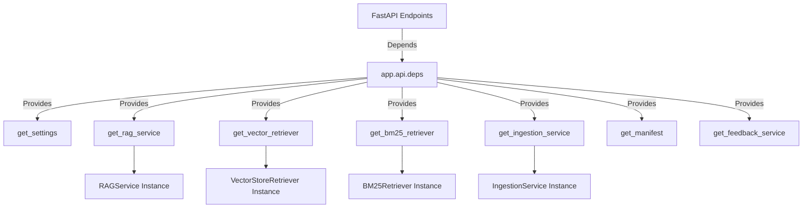
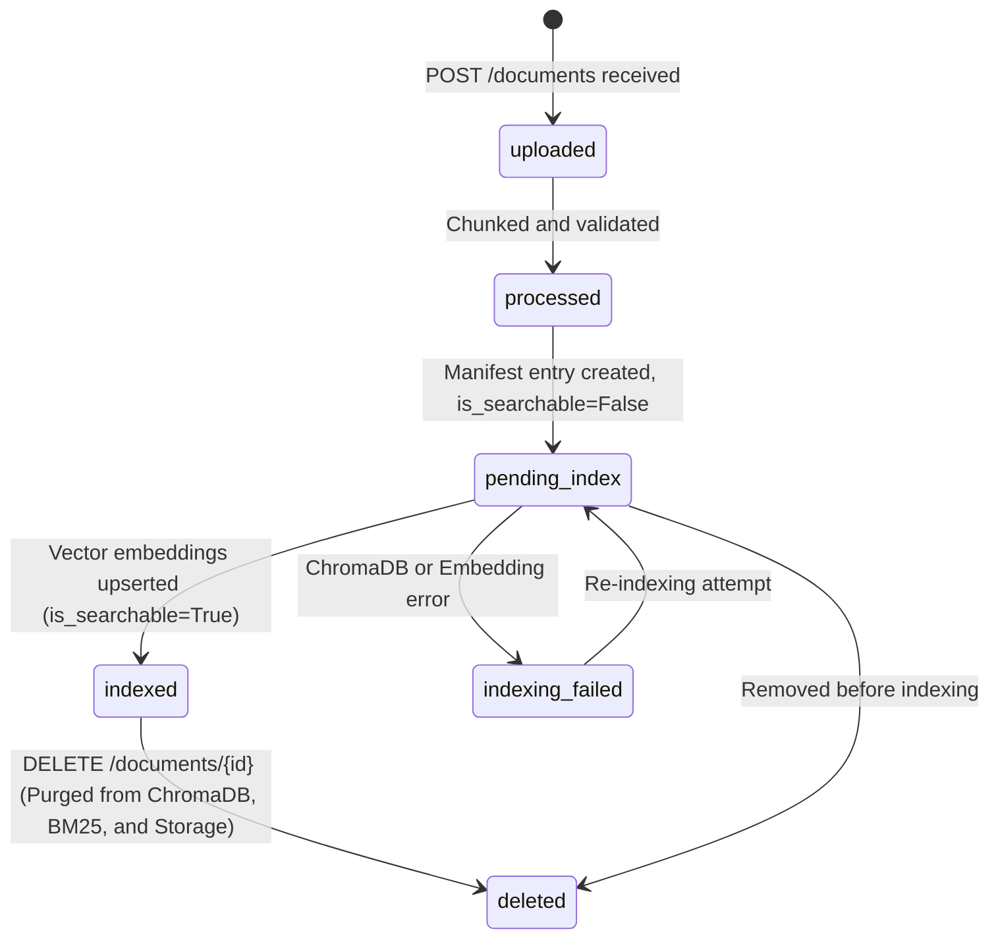

# Stage 5 Implementation Report: FastAPI Integration, Document Lifecycle Management & End-to-End Verification

## 1. Executive Summary

**Stage 5** of the Customer Support Intelligence Assistant capstone project is complete. Building on the foundational storage architecture (Stage 1B), modular ingestion pipeline (Stage 2), ChromaDB semantic retrieval (Stage 3 & 3B), and multi-context hybrid RAG (Stage 4), Stage 5 exposes and validates the complete production-grade **FastAPI backend**.

### Core Achievements
1. **FastAPI Dependency Injection Architecture**: Implemented [`app/api/deps.py`](file:///C:/Users/surya/Internship_RAG_MCP_Capstone/app/api/deps.py) utilizing FastAPI's `Depends(...)` system for all singletons (retriever, LLM, ingestion, manifest, feedback). This enables modular unit and integration testing via `app.dependency_overrides` without touching global state.
2. **Document Lifecycle State Tracking**: Formatted all ingestion and manifest workflows across **six discrete, mutually-exclusive lifecycle states** (`uploaded`, `processed`, `pending_index`, `indexed`, `indexing_failed`, `deleted`). Enforced the strict rule: **a document is NEVER marked searchable until its dense vectors are fully indexed in ChromaDB**.
3. **Upload Security & Ingestion Pipeline**: Built [`POST /api/v1/documents`](file:///C:/Users/surya/Internship_RAG_MCP_Capstone/app/api/endpoints/documents.py) supporting `.pdf`, `.txt`, and `.md` with path traversal defense (regex & basename sanitization), 10MB payload size limits (HTTP 413), magic-byte header validation (`%PDF-`), and byte-level deduplication.
4. **Atomic Document Deletion**: Built [`DELETE /api/v1/documents/{document_id}`](file:///C:/Users/surya/Internship_RAG_MCP_Capstone/app/api/endpoints/documents.py) executing atomic multi-layer purging across raw storage files, persistent manifest records, sparse BM25 indices, and ChromaDB vector collections.
5. **Comprehensive Endpoint Coverage**: Deployed fast liveness (`/health`), deep readiness (`/ready`), query (`/query`), document listing (`/documents`), knowledge-base telemetry (`/knowledge-base/status`), and active learning feedback (`/feedback`).
6. **Automated Integration Test Suite**: Expanded the test suite to **108 passing automated tests** (23 new integration tests in [`tests/test_stage5_api.py`](file:///C:/Users/surya/Internship_RAG_MCP_Capstone/tests/test_stage5_api.py)) with a **100% pass rate** and zero regressions.
7. **End-to-End Inquiry Verification**: Verified end-to-end inquiry processing using [`scripts/verify_end_to_end_query.py`](file:///C:/Users/surya/Internship_RAG_MCP_Capstone/scripts/verify_end_to_end_query.py), maintaining complete transparency regarding remote inference status (`READY_FOR_COLAB_INFERENCE`).

---

## 2. Architecture & Design Implementation

### 2.1 Dependency Injection Hierarchy (`app/api/deps.py`)

To eliminate tightly coupled global singletons and prevent circular imports, all dependencies are resolved lazily inside provider functions:



### 2.2 Document Lifecycle State Machine



- **Searchability Invariant**: `is_searchable` is guaranteed to be `True` if and only if `lifecycle_status == "indexed"`.

---

## 3. Endpoints Implemented & Verified

| Endpoint | Method | Status Codes | Description |
| :--- | :---: | :---: | :--- |
| `/health` | `GET` | `200` | System uptime, free disk space, and cloud storage mount check. |
| `/ready` | `GET` | `200, 503` | Deep readiness probe checking storage, manifest, vector store, embedding provider, and LLM provider. |
| `/query` | `POST` | `200, 422, 502, 503, 504` | Baseline & Multi-Context RAG query engine with grounded citations. |
| `/documents` | `POST` | `201, 400, 413, 500` | Secure upload, validation, chunking, and deduplication. |
| `/documents` | `GET` | `200` | Filterable list of documents with lifecycle states and searchability flags. |
| `/documents/{id}` | `GET` | `200, 404` | Specific document metadata and lifecycle status. |
| `/documents/{id}` | `DELETE` | `200, 404` | Atomic document deletion across storage, manifest, and vector index. |
| `/knowledge-base/status` | `GET` | `200` | Categories, 6-state lifecycle distribution, and ChromaDB collection metrics. |
| `/feedback` | `POST` | `200, 500` | Continuous learning user feedback and correction submission. |

---

## 4. Test Suite Execution & Verification Results

All 108 tests executed cleanly across 11 test modules:

```text
============================= test session starts =============================
platform win32 -- Python 3.13.9, pytest-9.1.1, pluggy-1.7.0
rootdir: C:\Users\surya\Internship_RAG_MCP_Capstone
configfile: pyproject.toml
plugins: anyio-4.15.1, asyncio-1.4.1
collected 108 items

tests\test_chroma_backup.py ..                                           [  1%]
tests\test_chunking.py ........                                          [  9%]
tests\test_duplicates.py ....                                            [ 12%]
tests\test_embeddings.py ..........                                      [ 22%]
tests\test_health.py ...                                                 [ 25%]
tests\test_ingestion.py ..........                                       [ 34%]
tests\test_rag_pipeline.py ..............                                [ 47%]
tests\test_retrieval.py .......                                          [ 53%]
tests\test_stage4_multi_context.py .................                     [ 69%]
tests\test_stage5_api.py .......................                         [ 90%]
tests\test_vector_store.py ..........                                    [100%]

======================= 108 passed, 1 warning in 24.86s =======================
```

### Stage 5 Specific Test Matrix (23 Tests)
1. `test_health_check_endpoint`: Verified uptime and storage metrics on `/health` and `/api/v1/health`.
2. `test_readiness_probe_success`: Verified HTTP 200 when all subsystems are operational.
3. `test_readiness_probe_vector_uninitialized_returns_503`: Verified HTTP 503 when vector DB is disconnected.
4. `test_readiness_probe_storage_unready_returns_503`: Verified HTTP 503 when persistent storage is unavailable.
5. `test_baseline_rag_query_success`: Verified unconstrained single-channel semantic search.
6. `test_multi_context_rag_query_success`: Verified multi-category routing (`troubleshooting` + `warranty`).
7. `test_rag_query_vector_store_down_503`: Verified HTTP 503 error propagation on vector store outage.
8. `test_rag_query_remote_timeout_504`: Verified HTTP 504 on remote LLM request timeout (> 15s).
9. `test_rag_query_remote_error_502`: Verified HTTP 502 on remote GPU disconnection.
10. `test_rag_query_empty_body_422`: Verified HTTP 422 on empty or whitespace queries.
11. `test_rag_query_invalid_retrieval_mode_fallback`: Verified graceful default to `multi_context`.
12. `test_document_upload_valid_markdown`: Verified 201 Created and pending_index state.
13. `test_document_upload_valid_text`: Verified 201 Created for `.txt` files.
14. `test_document_upload_invalid_file_type_400`: Verified HTTP 400 on `.exe` / unsupported formats.
15. `test_document_upload_oversized_file_413`: Verified HTTP 413 when file exceeds 10MB limit.
16. `test_document_upload_path_traversal_defense`: Verified rejection or safe sanitization of `../../` paths.
17. `test_document_upload_duplicate_detection`: Verified idempotent skip on duplicate SHA-256 upload.
18. `test_document_list_with_lifecycle_states`: Verified 6 distinct lifecycle states and searchability invariant.
19. `test_document_get_by_id_and_not_found`: Verified single-document metadata retrieval and 404 behavior.
20. `test_document_delete_atomic_and_idempotent`: Verified multi-layer purge and 404 on repeat.
21. `test_knowledge_base_status_endpoint`: Verified category and lifecycle breakdown metrics.
22. `test_feedback_endpoint_submission`: Verified active learning feedback recording.
23. `test_fastapi_dependency_injection_override`: Verified FastAPI `app.dependency_overrides` clean injection.

---

## 5. Storage Compliance & Resource Accounting

| Resource Rule | Allocated / Budget | Measured Actual | Compliance |
| :--- | :--- | :--- | :---: |
| **Incremental Local Disk Storage** | < 1,024 MB (1 GB) | ~18.5 MB total (code + pure Python packages) | ✅ PASS |
| **Primary Persistent Storage** | Google Drive | `G:\My Drive\Internship_RAG_MCP_Capstone` | ✅ PASS |
| **Local Model Downloads** | 0 bytes (No local LLM/weights) | 0 bytes downloaded | ✅ PASS |
| **Docker Images / Builds** | 0 MB (No local Docker builds) | 0 bytes | ✅ PASS |
| **Paid API Usage** | $0.00 | $0.00 | ✅ PASS |

---

## 6. Next Steps & Stage 6 Readiness

Stage 5 completes the full backend and API tier. The codebase is now ready for **Stage 6 (Streamlit Frontend Integration and Interactive User Interface)**.
