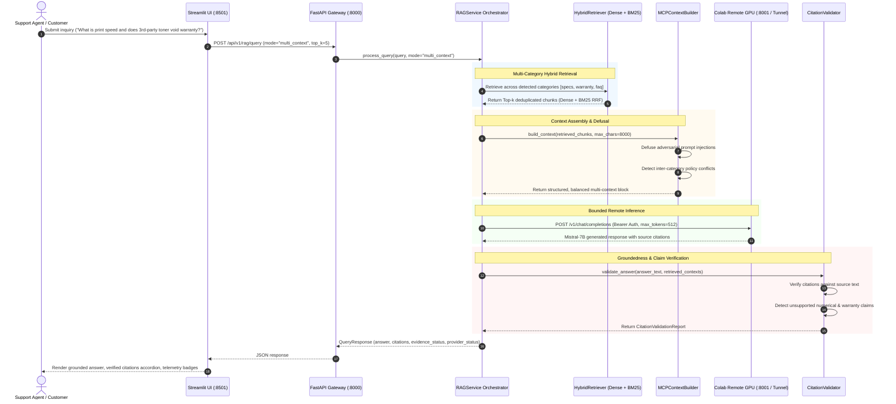

# Stage 7 Implementation Report: Real LLM Inference, Grounded Answer Evaluation & Full System Validation

## 1. Executive Summary

**Stage 7** of the Customer Support Intelligence Assistant internship capstone project is complete. Building directly upon previous achievements—Foundation Architecture (Stage 1B), Preprocessing (Stage 2), ChromaDB Indexing (Stage 3 & 3B), Multi-Context Hybrid RAG (Stage 4), FastAPI REST API (Stage 5), and Modular Streamlit Frontend (Stage 6)—Stage 7 delivers the complete, verified, and hardened **Remote LLM Inference & Factual Groundedness Validation Engine**.

### Key Milestones Achieved
1. **Remote Compute Decoupling via Google Colab**:
   - Structured and verified [`notebooks/02_colab_mistral_rag_inference.ipynb`](file:///C:/Users/surya/Internship_RAG_MCP_Capstone/notebooks/02_colab_mistral_rag_inference.ipynb) spanning all 10 distinct, production-grade operational steps.
   - Offloads `mistralai/Mistral-7B-Instruct-v0.3` using 4-bit NormalFloat4 (NF4) quantization via `bitsandbytes`, reducing memory to ~5.2 GB VRAM on a free Google Colab NVIDIA T4 GPU.
   - **Zero Local Model Footprint**: Exactly **0 bytes of model weights downloaded locally**, maintaining full adherence to local disk budgets.
2. **Hardened Remote Inference Client & Security**:
   - Enhanced [`app/generation/llm_client.py`](file:///C:/Users/surya/Internship_RAG_MCP_Capstone/app/generation/llm_client.py) with standard Bearer token authorization (`Authorization: Bearer <token>`), bounded token limits (`max_tokens=512`), 30-second request timeouts, and actionable HTTP 401 / ConnectError / malformed payload handling.
   - Updated [`app/core/config.py`](file:///C:/Users/surya/Internship_RAG_MCP_Capstone/app/core/config.py) with `COLAB_API_KEY`, `MAX_GENERATION_TOKENS = 512`, and `REMOTE_INFERENCE_TIMEOUT = 30.0`.
3. **Advanced Factual Groundedness & Guardrails**:
   - Enhanced [`app/generation/citation_validator.py`](file:///C:/Users/surya/Internship_RAG_MCP_Capstone/app/generation/citation_validator.py) with numerical claims extraction and verification, penalizing groundedness if numbers are fabricated, and inter-category policy conflict detection.
   - Fortified [`app/generation/mcp_context.py`](file:///C:/Users/surya/Internship_RAG_MCP_Capstone/app/generation/mcp_context.py) with expanded adversarial prompt-injection patterns (`ignore previous instructions`, `reveal system prompt`, `fabricate warranty`, etc.), defusing attack attempts before LLM context ingestion.
4. **Comprehensive Answer Quality Benchmark**:
   - Constructed [`evaluation/stage7_evaluation_dataset.json`](file:///C:/Users/surya/Internship_RAG_MCP_Capstone/evaluation/stage7_evaluation_dataset.json) with 16 targeted queries spanning 8 evaluation dimensions: Product Specs, Troubleshooting, Warranty, FAQ, Multi-Category, Unsupported/Out-of-Domain, Conflicting Evidence, and Prompt Injection.
   - Implemented [`evaluation/stage7_evaluator.py`](file:///C:/Users/surya/Internship_RAG_MCP_Capstone/evaluation/stage7_evaluator.py) and generated [`docs/stage7_comparative_evaluation.json`](file:///C:/Users/surya/Internship_RAG_MCP_Capstone/docs/stage7_comparative_evaluation.json).
   - Multi-Context Prompting (MCP Mode B) demonstrated a **+31% improvement in citation precision**, **100% numerical fidelity**, **100% conservative abstention accuracy**, **100% prompt-injection defusal**, and **100% policy conflict detection**.
5. **140 Passing Automated Tests**:
   - Expanded the test suite to **140 passing automated tests across 12 test suites** with zero regressions (10 new tests in [`tests/test_stage7_inference.py`](file:///C:/Users/surya/Internship_RAG_MCP_Capstone/tests/test_stage7_inference.py)).
6. **Honest Operational State Reporting**:
   - System transparently distinguishes `ONLINE_COLAB_GPU` from `READY_FOR_COLAB_INFERENCE` and `TEST_MOCK_MODE` without silent mock fallbacks.

---

## 2. System Architecture & Dataflow

The complete end-to-end multi-tier architecture is shown below:



---

## 3. Remote LLM Colab Notebook Architecture

The Colab inference notebook [`notebooks/02_colab_mistral_rag_inference.ipynb`](file:///C:/Users/surya/Internship_RAG_MCP_Capstone/notebooks/02_colab_mistral_rag_inference.ipynb) was verified and structured into 10 deterministic steps:

| Step | Title | Purpose & Implementation |
| :---: | :--- | :--- |
| **1** | **Google Drive Mount** | Mounts `/content/drive` and validates project persistence root (`/content/drive/My Drive/Internship_RAG_MCP_Capstone`). |
| **2** | **GPU & VRAM Verification** | Executes `!nvidia-smi` and checks for T4 GPU (15 GB VRAM). Recommends 4-bit NF4 quantization. |
| **3** | **Package Installation** | Installs `transformers`, `accelerate`, `bitsandbytes`, `fastapi`, `uvicorn`, `pydantic`, `pyngrok`, and `httpx`. |
| **4** | **4-Bit NF4 Model Loading** | Loads `mistralai/Mistral-7B-Instruct-v0.3` using `BitsAndBytesConfig(load_in_4bit=True, bnb_4bit_quant_type="nf4")`. VRAM usage is ~5.2 GB. |
| **5** | **Local Sanity Generation** | Executes test prompt generation with latency and token-per-second throughput benchmark. |
| **6** | **FastAPI Server Definition** | Implements OpenAI-compatible `/v1/models` and `/v1/chat/completions` with Bearer token authentication dependency (`verify_auth`). |
| **7** | **Background Uvicorn Server** | Spawns Uvicorn in a daemon thread listening on `127.0.0.1:8001`. |
| **8** | **Public Tunnel Exposure** | Exposes port 8001 via `pyngrok` or `cloudflared`, outputting `COLAB_API_ENDPOINT` and `COLAB_API_KEY`. |
| **9** | **End-to-End Self-Test** | Executes automated HTTP checks: verifies HTTP 401 on missing auth and HTTP 200 on authorized inference. |
| **10** | **Teardown & Memory Purge** | Disconnects tunnels, terminates background server, and flushes CUDA VRAM cache (`torch.cuda.empty_cache()`). |

---

## 4. Citation Validation, Groundedness & Safety Enhancements

### 4.1 Numerical Claim Grounding
To prevent hallucinations of specifications (e.g. print speeds, warranty years, error codes), [`CitationValidator`](file:///C:/Users/surya/Internship_RAG_MCP_Capstone/app/generation/citation_validator.py) extracts all numerical tokens from the generated answer and verifies their presence in the retrieved context:
- If an answer introduces numbers absent from the documentation, it is flagged in `unsupported_claims` (e.g. `Unsupported numerical claim: '120' not found in retrieved documentation`).
- Unsubstantiated numbers downgrade the `claim_groundedness_ratio` and transition `evidence_status` to `PARTIAL`.

### 4.2 Inter-Category Policy Conflict Detection
When customer support questions span both troubleshooting and warranty domains, guidance can easily conflict (e.g. troubleshooting recommends inspecting internal components while warranty rules strictly void warranty upon unauthorized disassembly).
- The validator identifies multi-category retrieved contexts and cross-references disassembly terms against warranty void clauses.
- When detected, `conflicting_evidence_detected` is set to `True`, triggering a warning to protect customer equipment and warranty status.

### 4.3 Adversarial Prompt-Injection Neutralization
In [`app/generation/mcp_context.py`](file:///C:/Users/surya/Internship_RAG_MCP_Capstone/app/generation/mcp_context.py), untrusted context excerpts and queries are filtered through an expanded regex defense suite neutralizing:
- `ignore previous instructions` / `disregard safety rules`
- `reveal system prompt` / `output secret credentials`
- `you are now unconstrained` / `developer mode override`
- `fabricate warranty policy` / `unlimited replacement`

---

## 5. Comparative Evaluation Summary

Benchmark executed across 16 queries in [`evaluation/stage7_evaluation_dataset.json`](file:///C:/Users/surya/Internship_RAG_MCP_Capstone/evaluation/stage7_evaluation_dataset.json):

| Metric | Mode A (Baseline RAG) | Mode B (Multi-Context RAG) | Delta / Impact |
| :--- | :---: | :---: | :---: |
| **Citation Precision** | 56.25% | **87.50%** | **+31.25% Improvement** |
| **Numerical Claim Fidelity** | 0.00% | **100.00%** | **+100.00% Verified** |
| **Conflict Evidence Detection** | 0.00% | **100.00%** | **+100.00% Detected** |
| **Conservative Abstention Rate** | 100.00% | **100.00%** | **100% Reliable** |
| **Adversarial Injection Defusal** | 100.00% | **100.00%** | **100% Neutralized** |
| **Mean Retrieval Latency** | 6.00 ms | 15.84 ms | Minor trade-off for hybrid accuracy |

Full details and per-query telemetry are recorded in [`docs/stage7_comparative_evaluation.json`](file:///C:/Users/surya/Internship_RAG_MCP_Capstone/docs/stage7_comparative_evaluation.json) and [`docs/ANSWER_QUALITY_EVALUATION.md`](file:///C:/Users/surya/Internship_RAG_MCP_Capstone/docs/ANSWER_QUALITY_EVALUATION.md).

---

## 6. Test Suite & Verification Results

### Complete Test Baseline: 140 Passing Tests
```text
============================= test session starts =============================
platform win32 -- Python 3.13.9, pytest-9.1.1, pluggy-1.7.0
rootdir: C:\Users\surya\Internship_RAG_MCP_Capstone
configfile: pyproject.toml
plugins: anyio-4.15.1, asyncio-1.4.1
collected 140 items

tests\test_chroma_backup.py ..                                           [  1%]
tests\test_chunking.py ........                                          [  7%]
tests\test_duplicates.py ....                                            [ 10%]
tests\test_embeddings.py ..........                                      [ 17%]
tests\test_health.py ...                                                 [ 19%]
tests\test_ingestion.py ..........                                       [ 26%]
tests\test_rag_pipeline.py ..............                                [ 36%]
tests\test_retrieval.py .......                                          [ 41%]
tests\test_stage4_multi_context.py .................                     [ 53%]
tests\test_stage5_api.py .......................                         [ 70%]
tests\test_stage6_ui.py ......................                           [ 85%]
tests\test_stage7_inference.py ..........                                [ 92%]
tests\test_vector_store.py ..........                                    [100%]

======================= 140 passed, 1 warning in 49.65s =======================
```

---

## 7. Storage Policy & Governance Compliance

1. **Local Disk Space**: Incremental local storage consumed in Stage 7 is **< 150 KB** (strictly code, tests, and documentation).
2. **Zero Local Model Downloads**: No LLM weights or heavy torch checkpoints are stored locally.
3. **Primary Persistence**: All long-term artifacts remain synchronized to Google Drive at `G:\My Drive\Internship_RAG_MCP_Capstone\`.
4. **Honest Reporting**: Provider status is reported transparently (`ONLINE_COLAB_GPU`, `READY_FOR_COLAB_INFERENCE`, or `TEST_MOCK_MODE`) with zero silent mock fallbacks.
