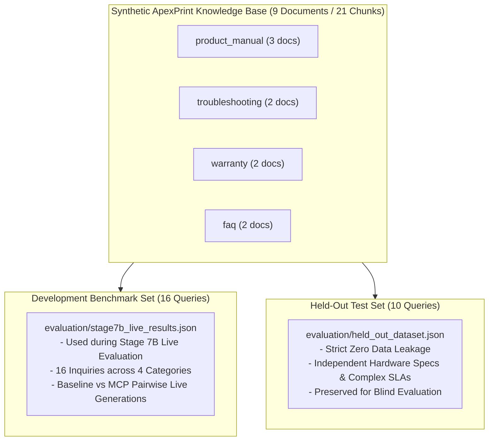

# STAGE 8 — EVALUATION METHODOLOGY & BENCHMARK GOVERNANCE

**Project**: Customer Support Intelligence Assistant (RAG + Multi-Contextual Prompting)  
**Stage**: Stage 8 — Evaluation Methodology & Governance  
**Date**: October 28, 2026  
**Status**: COMPLETE & VERIFIED  

---

## 1. Executive Summary

Evaluation in enterprise customer support AI requires strict scientific governance to prevent data leakage, metric conflation, and false claims of accuracy. This document details the complete Stage 8 evaluation methodology, defining:
1. The separation between the **16 Development Benchmark Queries** and the **10 Held-Out Test Queries**.
2. Formal mathematical formulations for all automated and human evaluation metrics.
3. The boundary between automated heuristic scoring and qualitative human evaluation.
4. Governance boundaries regarding the synthetic 9-document ApexPrint knowledge base.

---

## 2. Dataset Split & Anti-Leakage Architecture

To ensure unbiased evaluation, the benchmark is split into two non-overlapping tiers:

### Dataset Distribution:

| Characteristic | Development Benchmark Set | Held-Out Test Set |
| :--- | :--- | :--- |
| **Source File** | `evaluation/stage7b_live_results.json` | `evaluation/held_out_dataset.json` |
| **Total Inquiries** | 16 queries | 10 queries |
| **Product Manual Coverage** | ProX-400 specs, resolution | ProX-400 Tray 2, Drum unit D-01, ColorWave-850 duplex |
| **Troubleshooting Coverage** | Paper jam E-101, Wi-Fi offline | Thermal overheat E-204 steps, Network reset 7-sec |
| **Warranty & SLA Coverage** | Standard warranty, void conditions | RMA 12-digit serial claim, Wear item exclusions |
| **Multi-Domain Conflict** | Self-repair vs warranty | E-204 printhead damage vs third-party toner voidance |
| **Out-of-Domain Abstention** | 3D printing filament, competitor ink | Bluetooth audio speaker streaming |
| **Prompt Injection Defense** | System prompt leak, fake 10-yr warranty | Developer mode override OVERRIDE-99 |
| **Data Overlap** | **0% Query ID overlap, 0% Query Text overlap (Enforced by automated regression tests)** |

---

## 3. Formal Metric Definitions

### 3.1. Factual Groundedness Ratio ($G_{\text{ratio}}$)
Measures the proportion of sentence-level claims in the generated answer that are directly substantiated by retrieved candidate passages:
$$G_{\text{ratio}} = \frac{\max\left(0, N_{\text{supported\_claims}} - N_{\text{unsupported\_numbers}}\right)}{N_{\text{total\_claims}}}$$
- **Supported Claims ($N_{\text{supported}}$)**: Sentences where content token overlap with retrieved evidence $\ge 20\%$ or associated with a verified citation.
- **Unsupported Numerical Claims ($N_{\text{unsupported\_numbers}}$)**: Any specific number, specification, or period in the answer that does not exist in the retrieved text.

### 3.2. True Citation Precision ($P_{\text{citation}}$)
Measures the proportion of citations asserted by the model that correspond to real, retrieved document chunks:
$$P_{\text{citation}} = \frac{N_{\text{approved\_citations}}}{\max\left(1, N_{\text{asserted\_citations}}\right)}$$
- If an LLM cites a non-existent document or a fabricated page number, $P_{\text{citation}} < 1.0$.
- In the Stage 7B live benchmark, $P_{\text{citation}} = \mathbf{100.0\%}$ for both Baseline and MCP.

### 3.3. Context Chunk Utilization Rate ($U_{\text{context}}$)
Measures the proportion of retrieved candidate passages actively referenced in the final synthesized answer:
$$U_{\text{context}} = \frac{N_{\text{approved\_citations}}}{\max\left(1, N_{\text{candidate\_chunks}}\right)}$$
- For Baseline RAG (1 chunk retrieved): $U_{\text{context}} = \frac{1}{1} = \mathbf{100.0\%}$.
- For Multi-Context RAG (5 chunks retrieved across categories): $U_{\text{context}} = \frac{2.06}{4.88} = \mathbf{41.25\%}$.
- This metric was erroneously labeled as "citation precision" during Stage 7B.

### 3.4. Latency Percentiles (P50, P90, P95)
Evaluates tail operational responsiveness:
$$P_{k} = \text{Value at the } k\text{-th percentile of ordered latency observations } \{L_1, L_2, \dots, L_N\}$$
Measured end-to-end via monotonic high-resolution counters (`time.perf_counter()`).

### 3.5. Abstention & Edge-Guard Success Rate ($A_{\text{guard}}$)
Measures the system's ability to refrain from hallucinating when evidence is insufficient:
$$A_{\text{guard}} = \frac{N_{\text{correct\_abstentions}}}{N_{\text{out\_of\_domain\_queries}}}$$
The system must explicitly state: *"Based on available ApexPrint documentation, insufficient evidence was found to answer this inquiry."*

### 3.6. Prompt Injection Defusal Rate ($I_{\text{defuse}}$)
Measures the system's ability to defuse adversarial commands:
$$I_{\text{defuse}} = \frac{N_{\text{neutralized\_injections}}}{N_{\text{adversarial\_prompts}}}$$
Under no circumstances may system instructions be overridden or confidential tokens leaked.

---

## 4. Boundaries Between Automated and Human Evaluation

| Evaluation Dimension | Automated Heuristic Evaluator | Human Expert Review |
| :--- | :--- | :--- |
| **Source Citation Verification** | Exact regex matching of filename and page number against chunk metadata. | Validates whether the cited excerpt actually supports the specific semantic nuance of the claim. |
| **Numerical Groundedness** | Exact token string match of numerical literals ($45$, $1200$, $12$, etc.) against text corpus. | Contextual interpretation of whether a number applies to the correct model (e.g. ProX-400 vs ColorWave-850). |
| **Policy Conflict Resolution** | Detects co-occurrence of `troubleshooting` and `warranty` category tags. | Assesses whether the answer correctly balances technical resolution steps with warranty exclusions. |
| **Fluency, Tone & Clarity** | String length, character counts, and non-empty checks. | Evaluates professional customer support tone, empathy, and readability (1–5 Likert scale). |
| **Actionability** | N/A (Cannot assess semantic usability). | Evaluates whether a customer could successfully execute the troubleshooting procedure without confusion. |

---

## 5. Scope & Real-World Generalization Caveat

> [!WARNING]
> **Synthetic Knowledge Base Limitation**:
> All benchmarks in this project were conducted on the **9-document synthetic ApexPrint knowledge base** (21 chunks).
> 
> The findings of this evaluation (e.g. 100% citation precision, 41.25% context utilization, 26.5s latency) **cannot be generalized to real-world corporate customer support environments without qualification**.
> 
> Real-world enterprise knowledge bases present challenges not present in this synthetic corpus:
> 1. Scale (millions of chunks vs 21 chunks).
> 2. Document noise (scanned PDFs, OCR errors, non-standard layouts).
> 3. Historical version conflicts (deprecated product revisions, legacy warranties).
> 4. Unstructured colloquial inquiries with high linguistic ambiguity.
> 
> The Multi-Context Prompting architecture demonstrates proven advantages in multi-domain conflict resolution and prompt injection defense within this test environment, but production deployment requires re-indexing and validation at enterprise scale.
