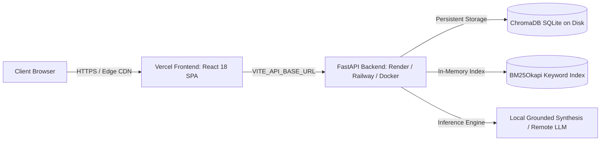

# Vercel Deployment Architecture & Production Setup Guide

**Project:** Customer Support Intelligence Platform  
**Release Tag:** `v1.0.0-rc1`  
**Classification:** Controlled Pilot Ready  
**Date:** 2026-11-22  

---

## 1. Executive Summary & Architecture Decision

This document details the deployment architecture, compatibility analysis, and step-by-step setup for deploying the Customer Support Intelligence Assistant with **Vercel**.

### Selected Architecture: Option A — Decoupled Deployment
- **Frontend:** Hosted on **Vercel** (Global Edge CDN, React 18, Vite SPA).
- **Backend:** Hosted on a **Containerized Python Service** (Render, Railway, AWS ECS/EC2, Fly.io, or on-premise Docker) with persistent disk storage for ChromaDB.
- **Inter-service Communication:** Secure REST API over HTTPS configured via `VITE_API_BASE_URL` with Cross-Origin Resource Sharing (CORS) whitelisting.



---

## 2. Architectural Audit: Why Serverless FastAPI on Vercel is Blocked

We evaluated running both the React frontend and FastAPI backend inside Vercel's Python Serverless Functions (Option B). This architecture is currently **BLOCKED** for the following technical reasons:

| Constraint | Vercel Serverless Function Limit | Application Requirement | Architectural Status |
|---|---|---|---|
| **Filesystem Persistence** | Read-only; ephemeral `/tmp` cleared between invocations | ChromaDB stores persistent SQLite (`chroma.sqlite3`) and embeddings on disk | **INCOMPATIBLE** (Uploaded documents and indices vanish on container spin-down) |
| **Function Bundle Size** | 250 MB unzipped / 50 MB zipped ceiling | PyTorch, `sentence-transformers`, `chromadb`, and C-extensions exceed 750 MB | **INCOMPATIBLE** (Exceeds AWS Lambda / Vercel deployment package limits) |
| **Cold Start Latency** | 10s timeout on Hobby (60s on Pro) | Initializing vector stores and embedding models takes 8–15 seconds on cold start | **RISK OF TIMEOUT** |
| **Concurrency & SQLite Lock** | Distributed stateless function invocations | SQLite database does not support multi-instance distributed file write locks | **DATA CORRUPTION RISK** |

> [!IMPORTANT]
> **Prerequisites for Future Full-Serverless Migration (Stage 9+ Roadmap):**  
> To make the backend serverless-compatible on Vercel, the application would require:
> 1. Migrating from local ChromaDB SQLite to a managed cloud vector database (e.g. Pinecone, Qdrant Cloud, or Supabase pgvector).
> 2. Offloading embedding generation to an external hosted API (e.g. OpenAI Embeddings or HuggingFace TEI endpoint) to eliminate PyTorch dependencies from the function bundle.

---

## 3. Step-by-Step Vercel Frontend Deployment

### Step 3.1: Connect GitHub Repository to Vercel
1. Log in to your [Vercel Dashboard](https://vercel.com/dashboard).
2. Click **Add New...** -> **Project**.
3. Import the GitHub repository: `https://github.com/suryacharan945/Customer-Support-Intelligence-RAG`.

### Step 3.2: Configure Project Settings
Vercel supports two deployment configurations depending on your preference:

#### Configuration Method 1: Root Directory Set to `web` (Recommended)
- **Project Name:** `customer-support-intelligence`
- **Framework Preset:** `Vite`
- **Root Directory:** Click `Edit` and select `web`
- **Build Command:** `npm run build` (or left default)
- **Output Directory:** `dist` (automatically detected)
- **Install Command:** `npm install`

#### Configuration Method 2: Monorepo Root Deployment
- **Root Directory:** `.` (Repository root)
- **Framework Preset:** `Vite`
- **Build Command:** `npm --prefix web run build`
- **Output Directory:** `web/dist`

*(The repository includes both `vercel.json` at root and `web/vercel.json` with SPA rewrites to support either method seamlessly).*

### Step 3.3: Configure Frontend Environment Variables
In the Vercel **Environment Variables** panel, add:

| Variable Name | Environment | Value Example | Description |
|---|---|---|---|
| `VITE_API_BASE_URL` | Production, Preview | `https://api.yourdomain.com/api/v1` | URL of your deployed FastAPI backend service. |
| `VITE_STREAMLIT_URL` | Optional | `https://streamlit.yourdomain.com` | URL of legacy demo interface (if hosted). |

> [!WARNING]
> Do NOT place backend secrets, database passwords, or private API keys in `VITE_` variables. All `VITE_` variables are baked into client-side JavaScript bundles and visible to anyone inspecting the browser source.

### Step 3.4: Deploy Preview & Verify
1. Click **Deploy**.
2. Wait for the build to complete (~30–45 seconds).
3. Access the generated preview URL (`https://customer-support-intelligence-xxx.vercel.app`).

---

## 4. Backend Deployment (Render / Railway / Docker)

To pair with your Vercel frontend, deploy the FastAPI backend to any container-compatible platform with persistent storage.

### Example: Deploying Backend on Render (or Railway)
1. **Repository:** Connect `https://github.com/suryacharan945/Customer-Support-Intelligence-RAG`.
2. **Environment:** Python 3.10+ or Docker.
3. **Build Command:** `pip install -r requirements.txt`
4. **Start Command:** `uvicorn app.main:app --host 0.0.0.0 --port $PORT`
5. **Disk / Volume:** Attach a persistent disk mounted to `/app/.chroma_live` (Minimum 1 GB).
6. **Environment Variables:**
   ```env
   ENVIRONMENT=production
   ALLOW_MOCK_FALLBACK=false
   LLM_PROVIDER=local
   ALLOW_LOCAL_FALLBACK=true
   LOCAL_EPHEMERAL_CHROMA_DIR=/app/.chroma_live
   CORS_ALLOWED_ORIGINS=https://customer-support-intelligence.vercel.app,https://*.vercel.app
   ```

---

## 5. Production CORS Configuration

When the React frontend runs on Vercel (`https://your-app.vercel.app`), browser cross-origin security requires the backend to permit the Vercel domain.

In your deployed backend environment, set:
```bash
CORS_ALLOWED_ORIGINS="https://your-app.vercel.app,https://your-app-*-yourteam.vercel.app"
```

The FastAPI backend automatically parses this comma-separated list into Starlette's `CORSMiddleware`, enabling preflight `OPTIONS` verification and credentials handling.

---

## 6. Post-Deployment Verification Checklist

Once both frontend and backend are live:
- [ ] **Frontend Loads:** Navigate to Vercel URL; check that Dashboard, Chat, and Knowledge Base views render.
- [ ] **Health Endpoint:** Verify backend connectivity: `curl https://api.yourdomain.com/api/v1/health` returns `{"status": "healthy"}`.
- [ ] **CORS Verification:** Submit a query from the Vercel UI; confirm browser developer console shows `200 OK` on `POST /api/v1/query` with no CORS origin errors.
- [ ] **Evidence Sufficiency:** Verify query returns formatted answer with citations and `SUFFICIENT` badge.
- [ ] **Abstention Verification:** Submit an out-of-domain query; verify clean `INSUFFICIENT` abstention without errors.
- [ ] **Document Management:** Verify `/documents` lists active files from persistent storage.
