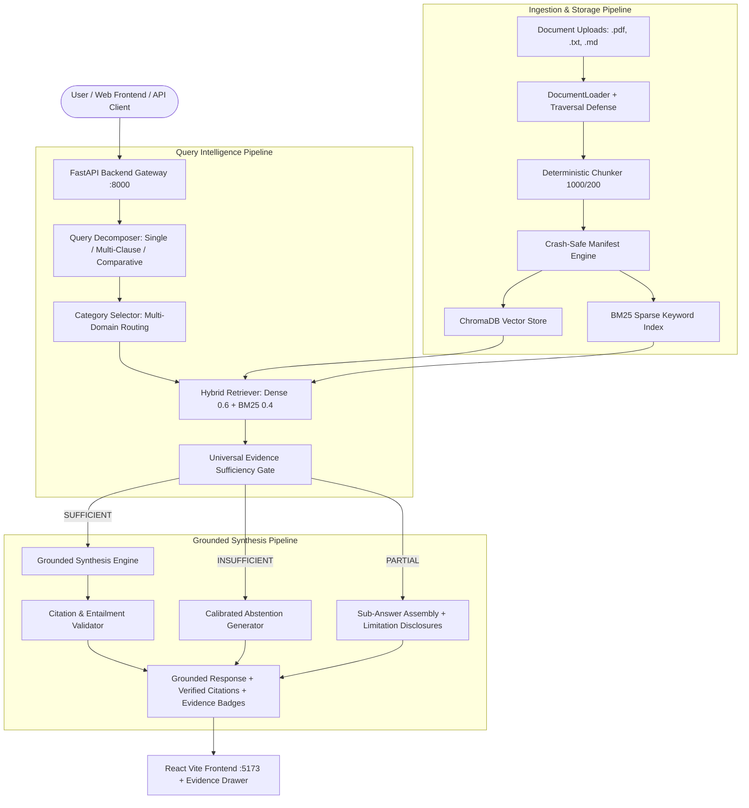

# System Architecture — Customer Support Intelligence & Document Intelligence Platform

**Release Version:** `v1.0.0-rc1`  
**Classification:** Release Candidate / Controlled Pilot Ready  
**Date:** 2026-11-16  

---

## 1. Executive Architecture Overview

The **Customer Support Intelligence Assistant / General-Purpose Document Intelligence Platform** is a production-grade, self-improving Retrieval-Augmented Generation (RAG) system with Multi-Context Prompting (MCP), query decomposition, universal evidence sufficiency gating, and verifiable citation validation.

The system is designed to prevent hallucinations, reject ungrounded or out-of-domain queries, and provide transparent, auditable evidence for all generated claims.

---

## 2. Core Architectural Components

### 2.1 Backend Gateway & FastAPI Architecture (`app/`)
- **Framework:** FastAPI with asynchronous ASGI execution (`app.main:app`).
- **Dependency Injection:** Centralized, decoupled providers in `app/api/deps.py` supporting runtime overrides and mock isolation.
- **Security Boundaries:**
  - Strict directory traversal protection (`..`, `/`, `\` sanitization).
  - 10 MB upload ceiling with HTTP 413 rejection.
  - Strict MIME and file format gating (`.pdf`, `.txt`, `.md`).
  - CORS middleware configured for cross-origin frontend communication.
  - Mock fallback isolation: `ALLOW_MOCK_FALLBACK = False` enforced in production and evaluation configurations.

### 2.2 Ingestion & Deduplication Pipeline (`app/ingestion/`)
- **Document Loading (`loader.py`):** Multi-format loader with UTF-8 normalization and PDF header `%PDF-` signature verification.
- **Recursive Chunking (`chunker.py`):** Deterministic sliding-window chunking (default 1,000 characters, 200 character overlap) preserving structural document headers and chunk IDs.
- **Manifest Engine (`manifest.py`):** Crash-safe SQLite/JSON manifest maintaining a 6-state document lifecycle:
  1. `uploaded`
  2. `processed`
  3. `pending_index`
  4. `indexed` (the **only** searchable state)
  5. `indexing_failed`
  6. `deleted` (atomic cleanup across ChromaDB, BM25, and disk)

### 2.3 Hybrid Retrieval & Multi-Context Prompting (`app/retrieval/`)
- **Dense Vector Search (`vector_store.py`):** ChromaDB persistent storage indexed with `all-MiniLM-L6-v2` embeddings (384-dimensional cosine space).
- **Sparse Keyword Search (`bm25.py`):** In-memory BM25Okapi keyword index capturing exact model numbers, error codes, and technical jargon.
- **Hybrid Fusion (`hybrid.py`):** Linear combination of dense and sparse scores ($\alpha = 0.6$ dense, $1 - \alpha = 0.4$ sparse) yielding superior recall compared to dense-only retrieval.
- **Multi-Context Routing (`category_selector.py`):** Category-aware query routing across multiple documentation domains (product manuals, troubleshooting, warranties, FAQs, engineering data).

### 2.4 Universal Evidence Sufficiency Engine (`app/retrieval/universal_evidence_sufficiency.py`)
- **Problem Solved:** Prevents single-clause and compound false acceptances caused by high lexical overlap with unrelated text.
- **Mechanisms:**
  - **Relevance Floor:** Dynamic similarity threshold ($s \ge 0.280$ for general queries, $s \ge 0.350$ for aspect-specific queries).
  - **Entity-Aspect Verification:** Verifies that both the target entity (e.g. `ProX-400`, `ColorWave 850`) and requested attribute (e.g. `print speed`, `resolution`, `warranty duration`) co-occur in the retrieved evidence chunks.
  - **Domain & Policy Boundary Check:** Identifies ungrounded predicates such as marketplace prices (Amazon, eBay), unauthorized disassemblies, internal credentials, or unindexed geographical facilities.
  - **4-Class Status Output:** Outputs strictly calibrated status:
    - `SUFFICIENT`: Full factual coverage across all query clauses.
    - `PARTIAL`: One or more sub-questions covered; others explicitly flagged as undocumented.
    - `INSUFFICIENT`: Absence of required evidence; triggers formal abstention.
    - `UNCERTAIN`: Edge case triggering human clarification review.

### 2.5 Compound Query Decomposition (`app/retrieval/query_decomposer.py`)
- Analyzes complex multi-part queries, conjunction clauses ("and what is its...", "as well as..."), and comparative queries ("Compare X and Y").
- Decomposes queries into focused, independent sub-questions with pronoun anaphora resolution.
- Evaluates evidence sufficiency independently per sub-question, ensuring that partially supported questions do not receive false full acceptance.

### 2.6 Verifiable Synthesis & Citation Validation (`app/generation/`)
- **Deterministic Synthesis Engine:** Generates structured, citation-grounded Markdown answers with:
  1. Executive Summary
  2. Step-by-Step Resolution / Technical Specifications
  3. Missing Information & Limitations Disclosures
  4. Verified Source Citations
- **Citation Validator (`citation_validator.py`):** Programmatically confirms chunk ID existence, source metadata integrity, and checks that every cited claim is entailed by the retrieved passage text.
- **LLM Decoupling (`llm_client.py`):** Cleanly supports remote Colab LLM inference (e.g. Mistral-7B-Instruct-v0.3), cloud APIs (Groq, Gemini), local Ollama, and native offline deterministic synthesis.

### 2.7 Document Intelligence React Frontend (`web/`)
- **Stack:** React 18, TypeScript, Vite, Tailwind CSS, Radix UI, Lucide icons.
- **Capabilities:**
  - Dark-mode responsive interface with real-time backend health monitoring.
  - Evidence Badges: `🟢 Sufficient Grounding`, `🟡 Partial Evidence`, `🔴 Insufficient Evidence`.
  - Interactive Evidence Drawer: Sliding panel displaying verbatim chunk excerpts, chunk IDs, page/section coordinates, relevance scores, and validity checks.
  - Multi-category document upload zone with format validation and lifecycle status tracking.
  - Human-in-the-loop active learning feedback dialog (star ratings, correction input, hallucination flagging).
