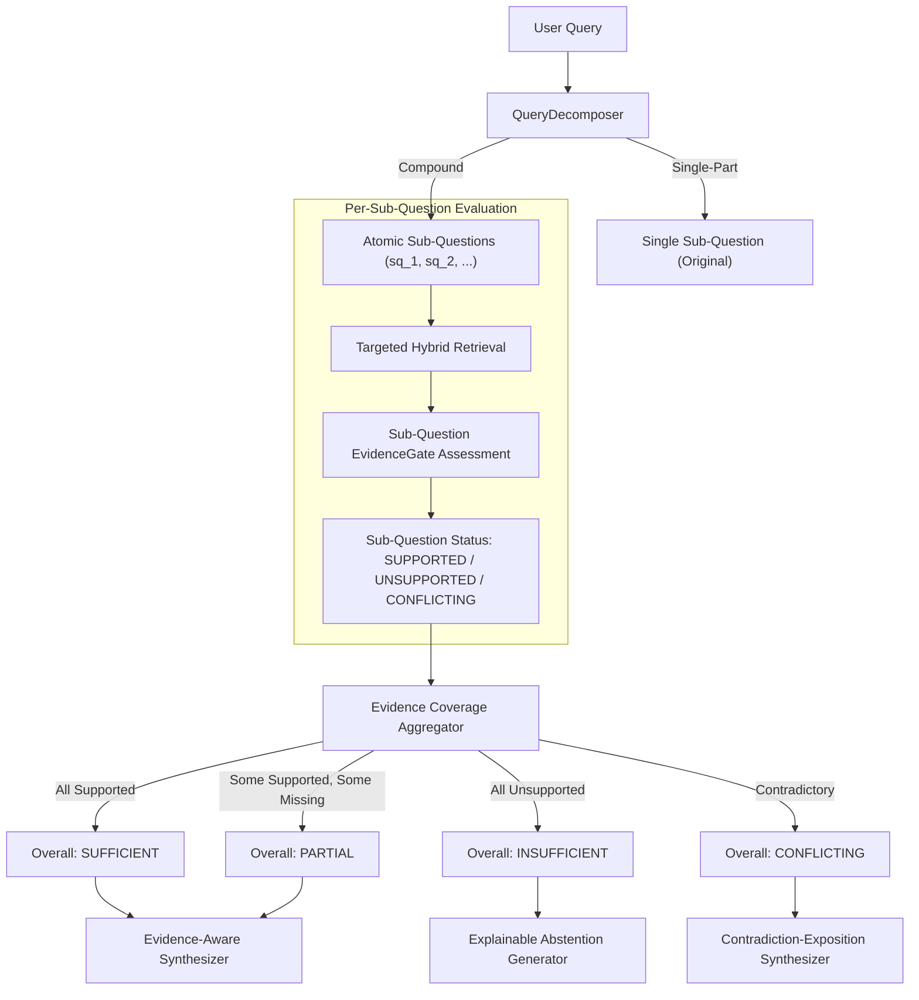

# STAGE 8 — PHASE 4.4: QUERY DECOMPOSITION DESIGN SPECIFICATION
## Sub-Question Decomposition, Multi-Requirement Parsing & Evidence Traceability

**Component**: `QueryDecomposer` (`app/retrieval/query_decomposer.py`)  
**Design Phase**: Stage 8 Phase 4.4  
**Architectural Goal**: Decompose complex, compound, comparative, and multi-clause inquiries into atomic, independently evaluable information requirements while preserving user intent, semantic dependencies, and single-part query fidelity.

---

## 1. Architectural Motivation

In Stage 8 Phase 4.2 and Phase 4.3, the system evaluated evidence sufficiency at the **global query level**:
1. All candidate chunks were retrieved for the entire raw query string.
2. The EvidenceGate checked whether the highest similarity score cleared $0.2800$.
3. If any single clause in a compound query achieved high similarity (e.g. warranty period), the global score cleared the floor, allowing ungrounded or absent clauses (e.g. international return address in `P4_2_VAL23`) to leak through to synthesis as `SUFFICIENT`.

To prevent this fundamental failure mode, Phase 4.4 transitions from **query-level gating** to **sub-question-level evidence sufficiency and claim-level answer grounding**.



---

## 2. Decomposition Typology & Semantic Strategies

The `QueryDecomposer` recognizes five distinct structural query types:

### 2.1 Type 1: Comparative Queries (`COMPARISON`)
- **Syntax Patterns**:
  - `Compare <Entity A> and <Entity B> [in/on/regarding] <Aspect 1> and <Aspect 2>`
  - `How do <Entity A> and <Entity B> compare in <Aspect 1> and <Aspect 2>?`
  - `What are the differences between <Entity A> and <Entity B> across <Aspects>?`
- **Transformation**:
  Expands into an $M \times K$ matrix of atomic sub-questions.
  - *Example*: *"Compare the ProX-400 and ColorWave-850 printing speeds and maintenance requirements."*
    - `sq_1`: *"What is the printing speed of the ProX-400?"* (Aspect: `printing_speed`, Entity: `ProX-400`)
    - `sq_2`: *"What is the printing speed of the ColorWave-850?"* (Aspect: `printing_speed`, Entity: `ColorWave-850`)
    - `sq_3`: *"What are the maintenance requirements of the ProX-400?"* (Aspect: `maintenance_requirements`, Entity: `ProX-400`)
    - `sq_4`: *"What are the maintenance requirements of the ColorWave-850?"* (Aspect: `maintenance_requirements`, Entity: `ColorWave-850`)

### 2.2 Type 2: Multi-Part Conjunctions (`CONJUNCTION`)
- **Syntax Patterns**:
  - `<Question 1> and <Question 2>?`
  - `<Clause 1>, where/how/what/when <Clause 2>?`
  - `<Clause 1> as well as <Clause 2>?`
- **Transformation**:
  Splits along coordinating conjunctions where both sides contain independent predicates or interrogatives.
  - *Example*: *"What is the standard warranty period and what is the exact physical mailing address for sending international return merchandise?"*
    - `sq_1`: *"What is the standard warranty period?"* (Aspect: `warranty_period`)
    - `sq_2`: *"What is the exact physical mailing address for sending international return merchandise?"* (Aspect: `international_return_address`)

### 2.3 Type 3: Conditional & Sequential Queries (`CONDITIONAL`)
- **Syntax Patterns**:
  - `Can I <Action 1>, and will that <Action 2 / Effect>?`
  - `If <Condition 1>, <Action 2> and <Action 3>?`
- **Transformation**:
  Separates the operational inquiry from the consequential/policy inquiry, resolving anaphoric pronouns ("that", "it") to the parent action.
  - *Example*: *"Can I disassemble the fuser myself, and will that affect warranty coverage?"*
    - `sq_1`: *"Is user disassembly of the fuser unit permitted?"* (Aspect: `self_disassembly_permission`)
    - `sq_2`: *"Will user disassembly of the fuser affect warranty coverage?"* (Aspect: `warranty_void_consequence`)

### 2.4 Type 4: Multi-Aspect Single-Entity Inquiries (`MULTI_ASPECT`)
- **Syntax Patterns**:
  - `What is the <Aspect 1> and <Aspect 2> of <Entity>?`
- **Transformation**:
  Generates targeted inquiries for each requested attribute while binding the common entity.
  - *Example*: *"What is the print resolution and bottle page yield of the ApexPrint EcoTank L3150?"*
    - `sq_1`: *"What is the print resolution of the ApexPrint EcoTank L3150?"*
    - `sq_2`: *"What is the bottle page yield of the ApexPrint EcoTank L3150?"*

### 2.5 Type 5: Single-Part Queries (`SINGLE_PART`)
- **Syntax Patterns**: Single clause, single predicate inquiries.
- **Transformation**:
  Preserves the query verbatim with zero modification:
  - `is_compound`: `False`
  - `sub_questions`: `[SubQuestion(id="sq_1", text=query, aspect="complete_query", importance=1.0)]`

---

## 3. Preservation & Guardrail Rules

To guarantee that the decomposer never degrades single-part queries or introduces noise:

1. **Fixed Collocation Protection**:
   The parser must never split inside idiomatic noun phrases or established technical entities:
   - `laser glass and corona wire` (Maintenance target)
   - `terms and conditions` / `warranty and exclusions` (Policy document title)
   - `hardware and software` / `research and development` (Domain phrase)
   - `feed rollers and separation pads` (Paper handling components)
   - `error codes and troubleshooting` (Manual chapter)
2. **Deterministic Fallback**:
   If a compound query cannot be split with high grammatical confidence, the system preserves the original query intact, logs a diagnostic warning, and processes it as a single-part query.
3. **Zero Parametric Hallucination**:
   Sub-questions are derived exclusively from the tokens and syntactic relationships in the user's prompt. No domain facts or assumed knowledge are injected into the sub-question text.
4. **No External API Dependencies**:
   Decomposition is executed entirely locally using deterministic regex, rule-based grammar analysis, and morphological normalization.

---

## 4. Evidence Coverage & Status Determination Schema

The coverage representation tracks:

```json
{
  "query_id": "P4_2_VAL23",
  "original_query": "What is the standard warranty period and what is the exact physical mailing address for sending international return merchandise?",
  "is_compound": true,
  "decomposition_type": "conjunction",
  "sub_question_count": 2,
  "sub_questions": [
    {
      "id": "sq_1",
      "text": "What is the standard warranty period?",
      "aspect": "warranty_period",
      "importance": 1.0,
      "evidence_status": "SUPPORTED",
      "supporting_chunks": ["doc_warr_11757ad6d7b8_c0001"],
      "confidence": 0.95
    },
    {
      "id": "sq_2",
      "text": "What is the exact physical mailing address for sending international return merchandise?",
      "aspect": "international_return_address",
      "importance": 1.0,
      "evidence_status": "UNSUPPORTED",
      "supporting_chunks": [],
      "confidence": 0.15
    }
  ],
  "supported_sub_question_count": 1,
  "unsupported_sub_question_count": 1,
  "conflicting_sub_question_count": 0,
  "coverage_ratio": 0.50,
  "overall_evidence_status": "PARTIAL",
  "decision_rationale": "Sub-question 1 (warranty period) is supported by retrieved warranty policy; Sub-question 2 (international return mailing address) has no supporting documentation in the knowledge base."
}
```

### Overall Decision Policy:
- $\text{Coverage} = 1.0 \land C = 0 \implies \mathbf{SUFFICIENT}$
- $0.0 < \text{Coverage} < 1.0 \land C = 0 \implies \mathbf{PARTIAL}$
- $\text{Coverage} == 0.0 \land C = 0 \implies \mathbf{INSUFFICIENT}$
- $C > 0 \implies \mathbf{CONFLICTING}$

This guarantees that a multi-part query with even one missing material requirement is **strictly classified as PARTIAL**, completely preventing the conjunction leak observed in `P4_2_VAL23`.
