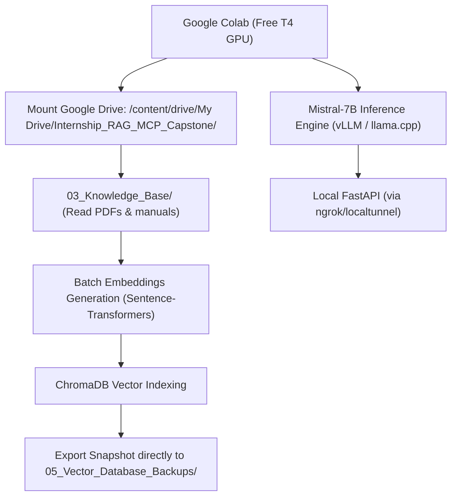

# Remote Compute Notebooks (Google Colab)

These Jupyter notebooks are designed to execute heavy computational workloads on **Google Colab** (using its free NVIDIA T4 GPU) while persisting all datasets, models, vector indexes, and evaluation benchmarks directly into your **5 TB Google Drive**.

## Workflow Architecture

## Notebooks

1. **`01_colab_embedding_and_chroma_indexing.ipynb`**:
   - Mounts Google Drive.
   - Ingests customer support knowledge base documents.
   - Generates vector embeddings with GPU acceleration.
   - Exports quiescent ChromaDB snapshot to `05_Vector_Database_Backups/`.
   - **Local disk usage**: 0 MB.

2. **`02_colab_mistral_rag_inference.ipynb`**:
   - Loads `Mistral-7B-Instruct-v0.3` (or 4-bit quantized GGUF) on Colab T4 GPU.
   - Starts an OpenAI-compatible REST server.
   - Exposes public tunnel URL for local FastAPI `COLAB_API_ENDPOINT`.
   - **Local disk usage**: 0 MB.
