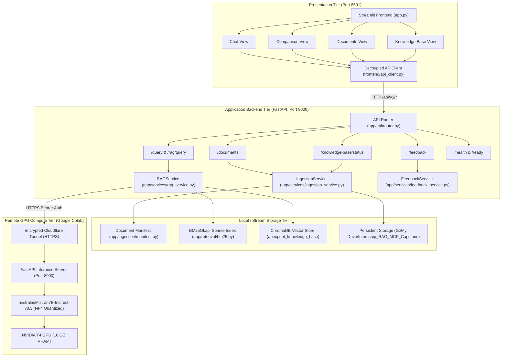
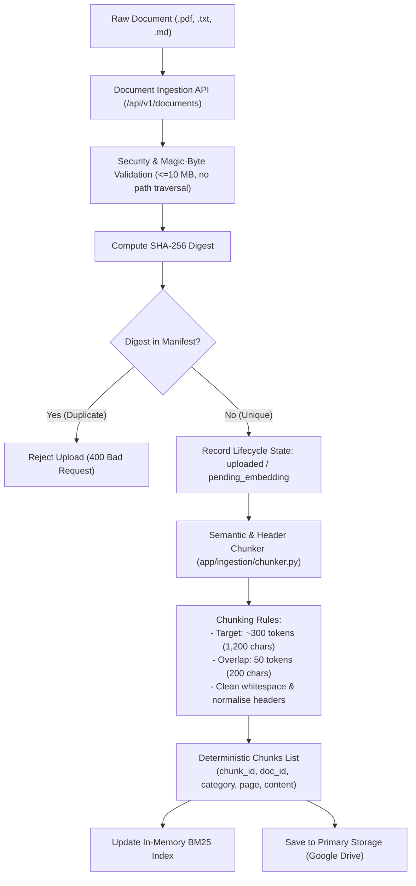
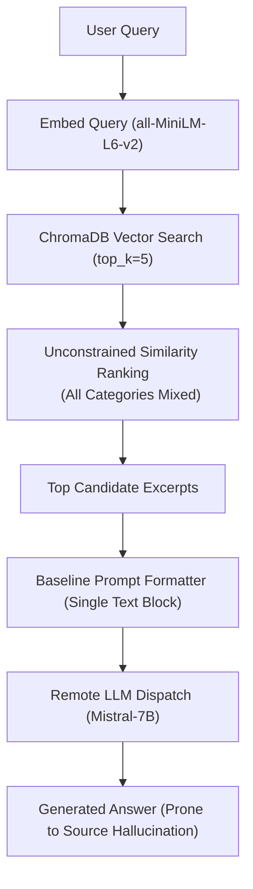
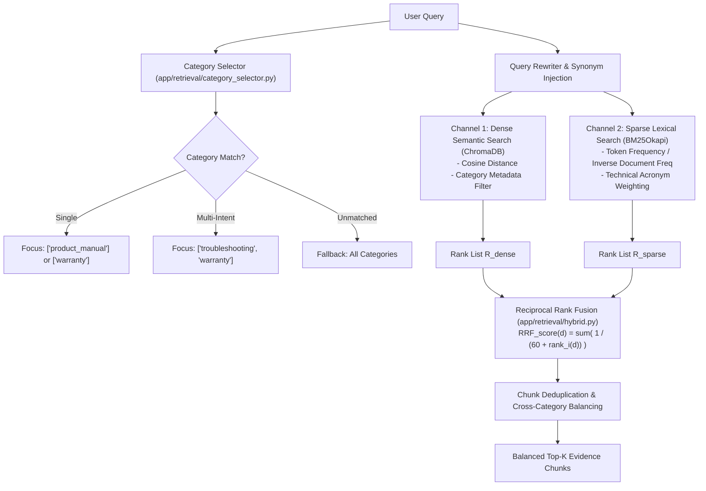
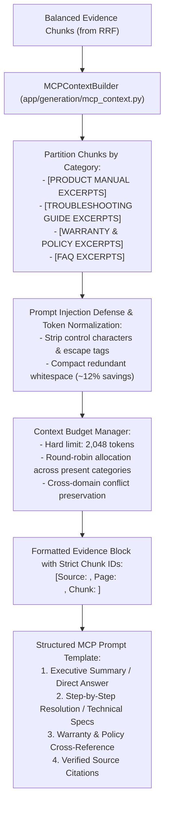
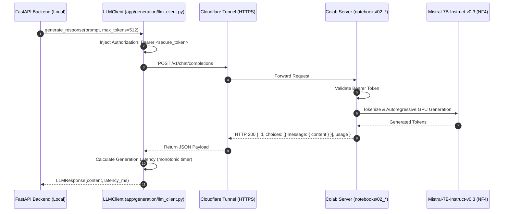
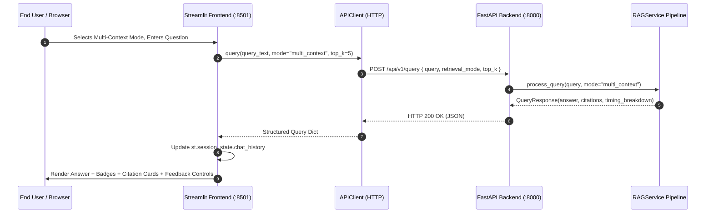
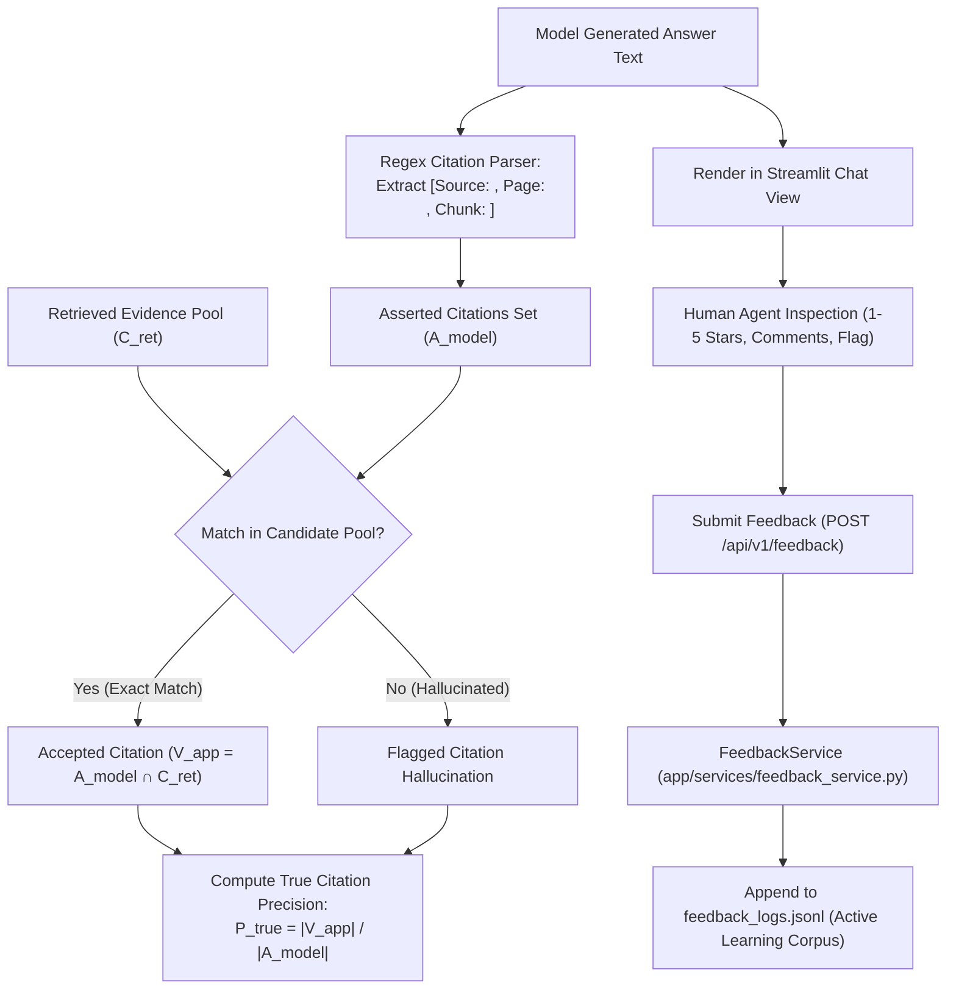
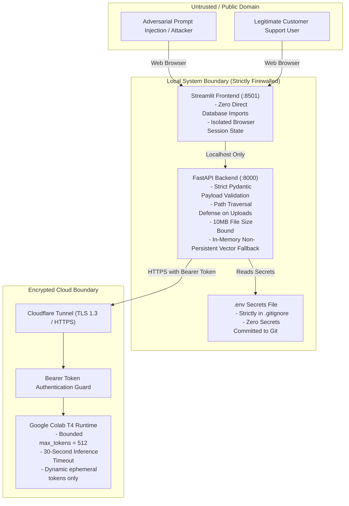

# Architectural Blueprint & System Diagrams

**Project**: Customer Support Intelligence Assistant (RAG + Multi-Contextual Prompting)  
**Repository**: `C:\Users\surya\Internship_RAG_MCP_Capstone`  
**Diagram Format**: GitHub-Flavored Markdown / Mermaid v10  
**Verification Baseline**: Commit `ee2f694`  
**Date**: 2026-10-28  

---

## 1. Overall System Architecture

The following diagram illustrates the three-tier decoupled architecture: Streamlit presentation layer, FastAPI application backend, and decoupled Google Colab remote GPU compute tier.

---

## 2. Document Ingestion Workflow

Demonstrates document processing, validation, SHA-256 duplicate detection, semantic chunking, and metadata extraction.

---

## 3. Embedding Generation & Vector Indexing

Illustrates the embedding pipeline and ChromaDB vector persistence.

```mermaid
flowchart LR
    CHUNKS["Deterministic Document Chunks"] --> EMB_SERVICE["Embedding Provider (app/retrieval/embeddings.py)"]
    
    EMB_SERVICE --> MODEL_SELECT{"Provider Mode?"}
    MODEL_SELECT -->|"Production / Colab"| ST_MODEL["sentence-transformers/all-MiniLM-L6-v2 (384-d)"]
    MODEL_SELECT -->|"Unit Test Fallback"| HASH_EMB["Deterministic Hash Embedder (384-d float)"]
    
    ST_MODEL --> NORM["L2 Vector Normalization"]
    HASH_EMB --> NORM
    
    NORM --> UPSERT["Controlled Vector Upsert (app/retrieval/vector_store.py)"]
    UPSERT --> COLLECTION["ChromaDB Collection: 'apexprint_knowledge_base'"]
    COLLECTION --> DIST["Distance Metric: Cosine Similarity"]
    
    COLLECTION --> BACKUP["Chroma Backup Service (app/retrieval/chroma_backup.py)"]
    BACKUP --> ARCHIVE["Tarball Snapshot -> Google Drive Storage"]
```

---

## 4. Dense Baseline Retrieval (Mode A)

Illustrates single-channel unconstrained dense vector search across the entire corpus.

---

## 5. Multi-Context Intent Routing & Hybrid Retrieval (Mode B)

Illustrates category-aware query decomposition, dual-channel retrieval, and Reciprocal Rank Fusion.

---

## 6. Multi-Context Partitioning & Context Assembly

Illustrates how retrieved chunks are assembled into structured blocks with strict budgeting and prompt injection defenses.

---

## 7. Remote Mistral-7B Inference Workflow

Illustrates authenticated remote inference offloaded to Google Colab T4 GPU.

---

## 8. FastAPI Backend & Streamlit Interaction

Illustrates request handling, session state management, and view rendering.

---

## 9. Citation Validation & Self-Improving Feedback Loop

Illustrates automated citation extraction, candidate verification, and human active learning logging.

---

## 10. Security & Operational Boundaries

Illustrates trust boundaries, credential containment, and execution limits.

